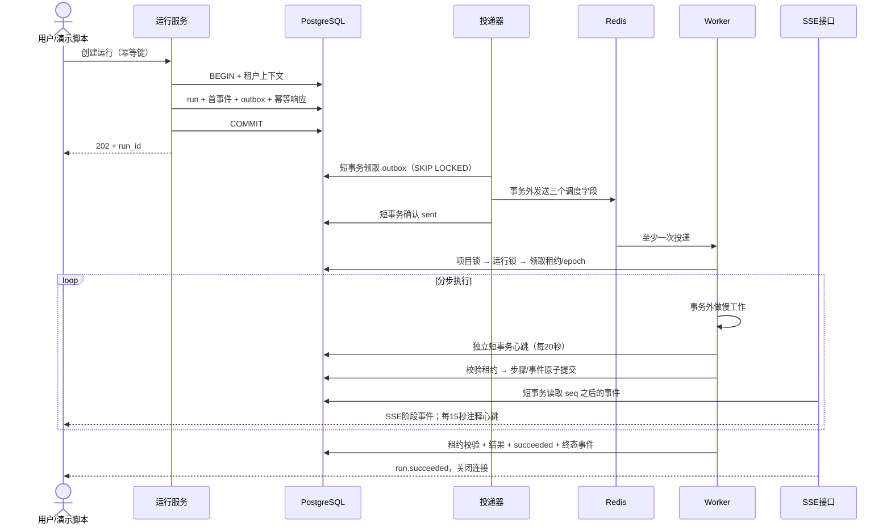

# A8 后台任务与运行事件：完整动手教程

> 编写日期：2026-10-13。依据当前仓库实际代码及四份开发文档编写，接着 A7 继续。
>
> **本文是供你逐步手动实现的教学文档。此次只新增本文，没有修改应用、迁移、配置、测试或 CI，没有安装依赖，也没有操作数据库。** 下文的“新增”“修改”“运行”都是你学习时需要自己执行的步骤。

## 1. 学完以后，你会得到什么

你会建立一条可以观察、可以取消、可以自动恢复的执行链：创建运行 → PostgreSQL 保存 → outbox 投递 → Redis 搬运 → Worker 领取租约 → 分步执行 → 保存结果和事件 → SSE 展示。

先完成一个等待约 30 秒的模拟任务。它只证明任务骨架能工作，不代表已实现文件解析、模型生成或招标分析。真实解析在 B2 接入，真实分析在 B3 接入，LangGraph 在 C2 接入。

建议每完成一节就停下来验证，不要一次复制整篇。

| 学习批次 | 建议时间 | 完成后应当能解释什么 |
|---|---|---|
| 读合同、状态机与测试 | 2–3 小时 | 为什么取消请求不是已取消 |
| 四张表、迁移、RLS、ORM | 4–5 小时 | 哪些操作必须在同一事务 |
| 创建、查询、取消、恢复、重试 | 4–5 小时 | 为什么 retry 要创建新运行 |
| 投递器、Worker、租约与巡检 | 6–8 小时 | 重复消息和旧 Worker 为什么不能重复提交 |
| SSE、演示、故障测试与 CI | 4–7 小时 | 为什么 Redis 丢消息后任务仍能恢复 |

第一次学习超过原任务的 20–28 小时很正常。优先逐条验收，不以“代码复制完了”作为完成标准。

### 1.1 本文核对的资料

| 资料 | 本文遵循的部分 |
|---|---|
| [开发文档](./dev/开发文档.md) | 2.2、4.1、4.5、7.1–7.3、8.2 |
| [数据库文档](./dev/数据库文档.md) | 3、9.1–9.3、12、13–16 |
| [API 文档](./dev/API文档.md) | 1–2、3.5、10、14 |
| [开发方案](./dev/开发方案.md) | 模块化单体、可靠执行、模拟与云端模式边界 |
| [小白开发](./dev/小白开发.md) | A8 及阶段一门禁 |
| [A6 教程](./A6-项目模块与统一接口规范-完整教学.md) | 事务服务、幂等、分页、统一错误 |
| [A7 教程](./A7-前端最小闭环-登录页与项目列表-完整教学.md) | 同源 Cookie、CSRF、前端请求风格 |

实际读过的代码包括 `modules/projects/service.py`、`repository.py`、`schemas.py`、`api/v1/projects.py`、`db/tenant.py`、`db/ops.py`、`modules/operations/idempotency.py`、身份模块、迁移 0004、集成测试夹具及现有 CI。

当前迁移 head 的 revision 是 `bcd589dc796d`，文件是 `0004_project_conventions.py`。你的历史迁移使用随机 revision；不要把文件名前缀 `0004` 误当成 revision。

### 1.2 延续你的代码风格

- 同步 SQLAlchemy、`Mapped` / `mapped_column`，保留已有数据库连接和真实角色。
- 请求与响应使用 Pydantic v2，字段写成 `Field(...)`，提供中文说明和限制。
- 路由处理 HTTP；service 管权限和事务；repository 写查询；domain 写纯规则。
- 参数逐项展开，重要参数使用 `*` 限定为关键字参数，函数写简短中文说明。
- 使用具名函数、显式变量、中文关键步骤注释，避免让初学者追踪复杂回调链。
- 复用 `Principal`、`authorize()`、`ApiError`、`tenant_transaction()`、`execute_idempotent()`、`WriteResult`、`ok()`、游标分页。

本文较长的模块分成多个代码块。标注“完整文件”的直接新建；标注“继续追加”的按顺序追加到同一个文件。**每个代码块的 import 也要保留，之后统一执行 Ruff 整理导入。**

### 1.3 先处理当前仓库与最终设计之间的阶段差异

1. A6 已有 `ops.idempotency_keys`，A8 不重新创建它。
2. `app.document_versions`、`app.project_baselines` 尚不存在。A8 先保留 `document_version_id`、`baseline_id` 字段；B2/B3 建表后再添加复合外键、验证存量数据，之后才开放真实任务入口。不要建立指向不存在表的外键。
3. `kind` 只允许设计中的六种，不能为了演示增加 `fake` 或 `demo`。本文用 `kind=analyze`、`model_mode=simulated`、服务端快照中的 `executor=a8_demo` 选择模拟执行器。这是内部开发夹具，不能当成 B3 的分析接口。
4. 模拟产物保存在 `run_steps.result_json`。运行绑定 `analysis_batch`，ID 为本运行 ID，符合 API 的引用形式；没有抽取要求或事实，结果明确标记 `simulated`，不能冒充真实分析成果。
5. A8 不提前开放 `/generation-runs`。它需要当前 baseline、章节版本和外发许可校验，留到相应业务阶段接入本骨架。
6. A6 的 `ensure_no_active_runs()` 仍是 TODO。A8 必须补上，且把 `retry_wait` 也算入非终态。

### 1.4 以后你手动实现时会涉及的文件

```text
backend/app/models/runs.py                    新增：Run / RunStep / RunEvent
backend/app/models/outbox.py                  新增：Outbox
backend/app/models/__init__.py                追加模型导出
backend/app/modules/runs/__init__.py          新增空文件
backend/app/modules/runs/domain.py            新增：状态机
backend/app/modules/runs/repository.py        新增：锁、短事务、事件
backend/app/modules/runs/schemas.py           新增：请求与响应
backend/app/modules/runs/service.py           新增：创建、查询、控制
backend/app/modules/runs/execution.py         新增：领取、节点、心跳
backend/app/modules/runs/stream.py            新增：SSE
backend/app/workers/__init__.py               新增空文件
backend/app/workers/celery_app.py             新增
backend/app/workers/tasks.py                  新增
backend/app/workers/dispatcher.py             新增
backend/app/workers/recovery.py               新增
backend/app/api/v1/runs.py                    新增
backend/app/main.py                          追加路由
backend/app/modules/projects/service.py       局部补归档检查
migrations/versions/<新revision>_a8_runs.py    新增
migrations/env.py                            追加模型注册导入
scripts/create_demo_run.py                    新增：内部演示入口
backend/tests/unit/test_run_domain.py         新增
backend/tests/integration/test_runs_a8.py     新增
.github/workflows/ci.yml                      追加 Redis 和可靠性测试
deploy/worker.Dockerfile                      新增：Linux Worker
deploy/compose.a8.yaml                        新增：开发 Worker 等进程
pyproject.toml / uv.lock                      安装 Celery 后更新
```

这个目录清单描述最终手动实现范围，不表示本次已经改动这些文件。

## 2. 先理解一次运行为什么要经过这么多环节



### 2.1 三个编号不要混淆

| 字段 | 解决的问题 | 什么时候增加 |
|---|---|---|
| `dispatch_generation` | 旧队列消息不能领取新一轮排队 | 每次重新排队并创建新 outbox |
| `lease_epoch` | 旧 Worker 不能提交结果 | 每次领取、使租约失效 |
| `last_event_seq` | SSE 有稳定顺序和重连位置 | 每次持久化事件 |

例如旧消息的世代为 1，运行已重新排队到 2，Worker 收到旧消息直接忽略。Worker A 持有 epoch=1，巡检失效后增加到 2，Worker B 再领取变成 3，A 就不能再提交。epoch 允许跳号，只要求严格递增，不要求每次加一后立刻有人执行。

### 2.2 我们要维护的六条不变量

1. 业务状态、步骤、事件、结果以 PostgreSQL 为准。
2. 创建运行的四类记录使用**同一个 Session、同一个事务**。
3. 所有需要项目锁与运行锁的地方，统一先项目、后运行。
4. 网络、模型调用、睡眠均在业务事务之外。
5. 节点提交检查组织、运行、owner、epoch、租约有效期及取消请求。
6. 状态改变和对应事件同事务提交；结果与成功事件也同事务提交。

## 3. 第一步：先写纯状态机和单元测试

纯函数只处理输入和输出，不连接数据库，不导入 FastAPI 或 Celery。

### 3.1 新增 domain.py，完整文件

```python
from enum import StrEnum


class RunStatus(StrEnum):
    QUEUED = "queued"
    RUNNING = "running"
    WAITING_INPUT = "waiting_input"
    RETRY_WAIT = "retry_wait"
    SUCCEEDED = "succeeded"
    FAILED = "failed"
    CANCELED = "canceled"


TERMINAL_STATUSES = frozenset({"succeeded", "failed", "canceled"})

# 排队投递长期失败、retry_wait 恢复耗尽，也必须能明确失败。
# 这是开发文档状态图的补充边界，回写文档时一并说明。
ALLOWED_TRANSITIONS: dict[RunStatus, frozenset[RunStatus]] = {
    RunStatus.QUEUED: frozenset(
        {
            RunStatus.RUNNING,
            RunStatus.CANCELED,
            RunStatus.FAILED,
        }
    ),
    RunStatus.RUNNING: frozenset(
        {
            RunStatus.WAITING_INPUT,
            RunStatus.RETRY_WAIT,
            RunStatus.SUCCEEDED,
            RunStatus.FAILED,
            RunStatus.CANCELED,
            RunStatus.QUEUED,
        }
    ),
    RunStatus.WAITING_INPUT: frozenset(
        {
            RunStatus.QUEUED,
            RunStatus.CANCELED,
        }
    ),
    RunStatus.RETRY_WAIT: frozenset(
        {
            RunStatus.QUEUED,
            RunStatus.CANCELED,
            RunStatus.FAILED,
        }
    ),
    RunStatus.SUCCEEDED: frozenset(),
    RunStatus.FAILED: frozenset(),
    RunStatus.CANCELED: frozenset(),
}


class InvalidTransition(ValueError):
    """当前状态不允许进入目标状态。"""


class LeaseLost(RuntimeError):
    """当前执行者已经失去提交资格。"""


class RetryableTaskError(RuntimeError):
    """已知可恢复错误，由数据库安排下一次执行。"""


def transition(current: str, target: str) -> RunStatus:
    """校验一次状态转换，返回合法的目标状态。"""
    try:
        current_status = RunStatus(current)
        target_status = RunStatus(target)
    except ValueError as exc:
        raise InvalidTransition("未知运行状态") from exc

    if target_status not in ALLOWED_TRANSITIONS[current_status]:
        raise InvalidTransition(f"不允许从 {current} 转为 {target}")

    return target_status
```

重复取消已 canceled 的任务应由服务直接返回原运行，不需要发明 `canceled → canceled` 的状态转换。重复消息也是先判断运行已经完成，然后忽略。

### 3.2 新增 test_run_domain.py，完整文件

```python
import pytest

from backend.app.modules.runs.domain import InvalidTransition, transition


@pytest.mark.parametrize(
    ("current", "target"),
    [
        ("queued", "running"),
        ("queued", "canceled"),
        ("queued", "failed"),
        ("running", "waiting_input"),
        ("running", "retry_wait"),
        ("running", "succeeded"),
        ("running", "failed"),
        ("running", "canceled"),
        ("running", "queued"),
        ("waiting_input", "queued"),
        ("waiting_input", "canceled"),
        ("retry_wait", "queued"),
        ("retry_wait", "canceled"),
        ("retry_wait", "failed"),
    ],
)
def test_legal_transition(current: str, target: str) -> None:
    assert transition(current, target) == target


@pytest.mark.parametrize(
    ("current", "target"),
    [
        ("succeeded", "running"),
        ("failed", "queued"),
        ("canceled", "running"),
        ("queued", "succeeded"),
        ("waiting_input", "succeeded"),
        ("running", "running"),
        ("unknown", "running"),
    ],
)
def test_illegal_transition(current: str, target: str) -> None:
    with pytest.raises(InvalidTransition):
        transition(current, target)
```

```powershell
Set-Location D:\proj\harness
uv run pytest backend/tests/unit/test_run_domain.py -q
```

应得到 21 条通过。用枚举集合生成测试虽然省事，但容易把实现中的同一个错误复制成测试，因此这里显式列出预期转换。

## 4. 第二步：编写四张表的迁移

### 4.1 先创建空迁移，不自动生成

```powershell
uv run alembic current
uv run alembic heads
uv run alembic revision -m "a8_runs"
```

保留新文件生成的 `revision`；确认 `down_revision` 指向你当前 head。本教程核对时为 `bcd589dc796d`。如果你已经增加了别的迁移，应接在新的 head 后，不能制造两个互相不知道的分支。

下面使用显式 SQL，延续 0004 的迁移风格。`upgrade()` 里面调用 `op.execute()`，字符串内容如下。这个代码块是 **upgrade 函数完整内容**；文件顶部保留 Alembic 生成的 revision 元数据和 `from alembic import op`。

```python
def upgrade() -> None:
    """建立运行、步骤、事件、待投递记录及最小权限。"""
    op.execute("""
        CREATE TABLE app.runs (
            id uuid PRIMARY KEY DEFAULT gen_random_uuid(),
            org_id uuid NOT NULL REFERENCES auth.organizations(id),
            project_id uuid,
            kind varchar(20) NOT NULL,
            chapter_id uuid,
            document_version_id uuid,
            baseline_id uuid,
            retry_of_run_id uuid,
            status varchar(30) NOT NULL DEFAULT 'queued',
            cancel_requested boolean NOT NULL DEFAULT false,
            input_snapshot jsonb NOT NULL,
            snapshot_hash char(64) NOT NULL,
            model_mode varchar(20) NOT NULL,
            current_step varchar(100),
            max_calls integer NOT NULL DEFAULT 0,
            max_tokens bigint NOT NULL DEFAULT 0,
            max_cost_cny numeric(18,6),
            calls_started integer NOT NULL DEFAULT 0,
            tokens_observed bigint NOT NULL DEFAULT 0,
            tokens_reserved bigint NOT NULL DEFAULT 0,
            cost_observed_cny numeric(18,6) NOT NULL DEFAULT 0,
            cost_reserved_cny numeric(18,6) NOT NULL DEFAULT 0,
            has_unknown_calls boolean NOT NULL DEFAULT false,
            lease_owner uuid,
            lease_epoch bigint NOT NULL DEFAULT 0,
            lease_expires_at timestamptz,
            heartbeat_at timestamptz,
            dispatch_generation integer NOT NULL DEFAULT 1,
            recovery_count integer NOT NULL DEFAULT 0,
            next_attempt_at timestamptz,
            resume_payload jsonb,
            artifact_type varchar(50),
            artifact_id uuid,
            error_code varchar(100),
            error_message text,
            error_retryable boolean NOT NULL DEFAULT false,
            last_event_seq bigint NOT NULL DEFAULT 0,
            created_by uuid NOT NULL,
            started_at timestamptz,
            finished_at timestamptz,
            created_at timestamptz NOT NULL DEFAULT now(),
            updated_at timestamptz NOT NULL DEFAULT now(),
            CONSTRAINT uq_runs_org_id UNIQUE (org_id, id),
            CONSTRAINT uq_runs_org_project_id UNIQUE (org_id, project_id, id),
            CONSTRAINT fk_runs_project FOREIGN KEY (org_id, project_id)
                REFERENCES app.projects(org_id, id),
            CONSTRAINT fk_runs_chapter FOREIGN KEY (org_id, project_id, chapter_id)
                REFERENCES app.chapters(org_id, project_id, id),
            CONSTRAINT fk_runs_retry FOREIGN KEY (org_id, retry_of_run_id)
                REFERENCES app.runs(org_id, id),
            CONSTRAINT fk_runs_creator FOREIGN KEY (org_id, created_by)
                REFERENCES auth.users(org_id, id),
            CONSTRAINT ck_runs_kind CHECK
                (kind IN ('parse','index','analyze','generate','review','export')),
            CONSTRAINT ck_runs_status CHECK
                (status IN ('queued','running','waiting_input','retry_wait',
                            'succeeded','failed','canceled')),
            CONSTRAINT ck_runs_model_mode CHECK
                (model_mode IN ('none','cloud','simulated')),
            CONSTRAINT ck_runs_targets CHECK (
                (project_id IS NOT NULL OR kind IN ('parse','index'))
                AND (kind NOT IN ('parse','index') OR document_version_id IS NOT NULL)
                AND (kind <> 'generate' OR chapter_id IS NOT NULL)
                AND (chapter_id IS NULL OR project_id IS NOT NULL)
                AND (kind NOT IN ('generate','review') OR baseline_id IS NOT NULL)
            ),
            CONSTRAINT ck_runs_budget CHECK (
                max_calls >= 0 AND max_tokens >= 0
                AND (max_cost_cny IS NULL OR max_cost_cny >= 0)
                AND calls_started >= 0 AND tokens_observed >= 0 AND tokens_reserved >= 0
                AND cost_observed_cny >= 0 AND cost_reserved_cny >= 0
            ),
            CONSTRAINT ck_runs_counters CHECK (
                lease_epoch >= 0 AND dispatch_generation >= 1
                AND recovery_count BETWEEN 0 AND 3 AND last_event_seq >= 0
            ),
            CONSTRAINT ck_runs_lease CHECK (
                (status = 'running' AND lease_owner IS NOT NULL
                 AND lease_expires_at IS NOT NULL)
                OR (status <> 'running' AND lease_owner IS NULL
                    AND lease_expires_at IS NULL)
            ),
            CONSTRAINT ck_runs_artifact CHECK
                ((artifact_type IS NULL) = (artifact_id IS NULL))
        );
        CREATE INDEX ix_runs_project_created ON app.runs
            (org_id, project_id, created_at DESC, id DESC);
        CREATE INDEX ix_runs_due ON app.runs (org_id, status, next_attempt_at)
            WHERE status IN ('queued','retry_wait');
        CREATE INDEX ix_runs_expired ON app.runs (org_id, lease_expires_at)
            WHERE status = 'running';
        CREATE INDEX ix_runs_generate_leases ON app.runs
            (org_id, project_id, lease_expires_at)
            WHERE kind = 'generate' AND status = 'running';

        CREATE TABLE app.run_steps (
            id uuid PRIMARY KEY DEFAULT gen_random_uuid(),
            org_id uuid NOT NULL REFERENCES auth.organizations(id),
            run_id uuid NOT NULL,
            step_key varchar(150) NOT NULL,
            node_name varchar(100) NOT NULL,
            status varchar(20) NOT NULL DEFAULT 'pending',
            attempt_count integer NOT NULL DEFAULT 0,
            lease_epoch bigint NOT NULL,
            input_hash char(64) NOT NULL,
            result_json jsonb,
            error_code varchar(100),
            started_at timestamptz,
            finished_at timestamptz,
            created_at timestamptz NOT NULL DEFAULT now(),
            updated_at timestamptz NOT NULL DEFAULT now(),
            CONSTRAINT uq_steps_org_id UNIQUE (org_id, id),
            CONSTRAINT uq_steps_key UNIQUE (org_id, run_id, step_key),
            CONSTRAINT fk_steps_run FOREIGN KEY (org_id, run_id)
                REFERENCES app.runs(org_id, id),
            CONSTRAINT ck_steps_status CHECK
                (status IN ('pending','running','succeeded','failed','skipped')),
            CONSTRAINT ck_steps_counters CHECK (attempt_count >= 0 AND lease_epoch >= 0)
        );

        CREATE TABLE app.run_events (
            id uuid PRIMARY KEY DEFAULT gen_random_uuid(),
            org_id uuid NOT NULL REFERENCES auth.organizations(id),
            run_id uuid NOT NULL,
            seq bigint NOT NULL,
            event_type varchar(100) NOT NULL,
            payload_json jsonb NOT NULL,
            created_at timestamptz NOT NULL DEFAULT now(),
            CONSTRAINT uq_events_org_id UNIQUE (org_id, id),
            CONSTRAINT uq_events_seq UNIQUE (org_id, run_id, seq),
            CONSTRAINT fk_events_run FOREIGN KEY (org_id, run_id)
                REFERENCES app.runs(org_id, id),
            CONSTRAINT ck_events_seq CHECK (seq > 0)
        );
        CREATE INDEX ix_events_created ON app.run_events (created_at);

        CREATE TABLE ops.outbox (
            id uuid PRIMARY KEY DEFAULT gen_random_uuid(),
            org_id uuid NOT NULL REFERENCES auth.organizations(id),
            run_id uuid NOT NULL,
            dispatch_generation integer NOT NULL,
            status varchar(20) NOT NULL DEFAULT 'pending',
            available_at timestamptz NOT NULL DEFAULT now(),
            claim_owner uuid,
            claim_expires_at timestamptz,
            attempt_count integer NOT NULL DEFAULT 0,
            sent_at timestamptz,
            last_error_code varchar(100),
            created_at timestamptz NOT NULL DEFAULT now(),
            updated_at timestamptz NOT NULL DEFAULT now(),
            CONSTRAINT uq_outbox_org_id UNIQUE (org_id, id),
            CONSTRAINT uq_outbox_generation UNIQUE (org_id, run_id, dispatch_generation),
            CONSTRAINT fk_outbox_run FOREIGN KEY (org_id, run_id)
                REFERENCES app.runs(org_id, id),
            CONSTRAINT ck_outbox_status CHECK (status IN ('pending','sending','sent','failed')),
            CONSTRAINT ck_outbox_counters CHECK
                (dispatch_generation >= 1 AND attempt_count >= 0),
            CONSTRAINT ck_outbox_claim CHECK (
                (status = 'sending' AND claim_owner IS NOT NULL AND claim_expires_at IS NOT NULL)
                OR (status <> 'sending' AND claim_owner IS NULL AND claim_expires_at IS NULL)
            )
        );
        CREATE INDEX ix_outbox_available ON ops.outbox (status, available_at)
            WHERE status IN ('pending','sending','failed');
        CREATE INDEX ix_outbox_claim_expired ON ops.outbox (claim_expires_at)
            WHERE status = 'sending';
    """)

    for table in ("runs", "run_steps", "run_events"):
        # table 来自代码中的固定白名单，不是用户输入。
        op.execute(f"""
            REVOKE ALL ON app.{table} FROM PUBLIC, auth_service, ops_runtime;
            GRANT SELECT, INSERT, UPDATE ON app.{table} TO app_runtime;
            ALTER TABLE app.{table} ENABLE ROW LEVEL SECURITY;
            ALTER TABLE app.{table} FORCE ROW LEVEL SECURITY;
            CREATE POLICY {table}_tenant_policy ON app.{table}
            FOR ALL TO app_runtime
            USING (org_id = NULLIF(current_setting('app.current_org_id', true), '')::uuid)
            WITH CHECK (org_id = NULLIF(current_setting('app.current_org_id', true), '')::uuid);
        """)

    op.execute("""
        REVOKE ALL ON ops.outbox FROM PUBLIC, auth_service, ops_runtime;
        GRANT USAGE ON SCHEMA ops TO app_runtime, ops_runtime;
        GRANT SELECT, INSERT, UPDATE ON ops.outbox TO app_runtime;
        GRANT SELECT, UPDATE ON ops.outbox TO ops_runtime;
        ALTER TABLE ops.outbox ENABLE ROW LEVEL SECURITY;
        ALTER TABLE ops.outbox FORCE ROW LEVEL SECURITY;
        CREATE POLICY outbox_tenant_policy ON ops.outbox FOR ALL TO app_runtime
        USING (org_id = NULLIF(current_setting('app.current_org_id', true), '')::uuid)
        WITH CHECK (org_id = NULLIF(current_setting('app.current_org_id', true), '')::uuid);
        CREATE POLICY outbox_dispatch_policy ON ops.outbox FOR ALL TO ops_runtime
        USING (true) WITH CHECK (true);
    """)
```

`ops_runtime` 只能 SELECT/UPDATE outbox，不能读 `runs`，也不能 INSERT outbox。创建新一轮投递记录由业务连接在租户事务中完成。`FORCE RLS` 不能阻止超级用户绕过，因此测试必须使用真实 `app_runtime`，不能拿管理连接代替。

这里没有给后台进度添加 `lock_version`。API 1.5 明确后台进度不递增用户编辑锁；运行控制使用状态、行锁、幂等和租约。

同一迁移文件中填写 downgrade：

```python
def downgrade() -> None:
    """仅用于本地空练习数据回退；有业务数据时先评估保留方案。"""
    op.execute("DROP TABLE ops.outbox")
    op.execute("DROP TABLE app.run_events")
    op.execute("DROP TABLE app.run_steps")
    op.execute("DROP TABLE app.runs")
```

### 4.2 ORM 映射怎样写

新增 `backend/app/models/runs.py`，完整文件如下。迁移是结构的权威来源；这里提供字段映射和外键关系。较长的 CHECK 和额外查询索引由显式迁移维护，不依赖 `create_all()` 建库。后续若采用 autogenerate，应先把迁移中的约束/索引同步进 metadata，并审核差异，不能直接接受“删除索引”的建议。

```python
import uuid
from datetime import datetime
from decimal import Decimal
from typing import Any

from sqlalchemy import (
    CHAR,
    BigInteger,
    Boolean,
    DateTime,
    ForeignKey,
    ForeignKeyConstraint,
    Integer,
    Numeric,
    String,
    Text,
    UniqueConstraint,
    func,
    text,
)
from sqlalchemy.dialects.postgresql import JSONB
from sqlalchemy.dialects.postgresql import UUID as PGUUID
from sqlalchemy.orm import Mapped, mapped_column

from backend.app.db.base import Base


class Run(Base):
    """一次执行的状态、冻结输入、预算与租约。"""

    __tablename__ = "runs"
    __table_args__ = (
        UniqueConstraint("org_id", "id", name="uq_runs_org_id"),
        UniqueConstraint("org_id", "project_id", "id", name="uq_runs_org_project_id"),
        ForeignKeyConstraint(["org_id", "project_id"], ["app.projects.org_id", "app.projects.id"]),
        ForeignKeyConstraint(
            ["org_id", "project_id", "chapter_id"],
            ["app.chapters.org_id", "app.chapters.project_id", "app.chapters.id"],
        ),
        ForeignKeyConstraint(["org_id", "retry_of_run_id"], ["app.runs.org_id", "app.runs.id"]),
        ForeignKeyConstraint(["org_id", "created_by"], ["auth.users.org_id", "auth.users.id"]),
        {"schema": "app"},
    )

    id: Mapped[uuid.UUID] = mapped_column(
        PGUUID(as_uuid=True),
        primary_key=True,
        default=uuid.uuid4,
        server_default=text("gen_random_uuid()"),
    )
    org_id: Mapped[uuid.UUID] = mapped_column(
        PGUUID(as_uuid=True), ForeignKey("auth.organizations.id")
    )
    project_id: Mapped[uuid.UUID | None] = mapped_column(PGUUID(as_uuid=True))
    kind: Mapped[str] = mapped_column(String(20))
    chapter_id: Mapped[uuid.UUID | None] = mapped_column(PGUUID(as_uuid=True))
    document_version_id: Mapped[uuid.UUID | None] = mapped_column(PGUUID(as_uuid=True))
    baseline_id: Mapped[uuid.UUID | None] = mapped_column(PGUUID(as_uuid=True))
    retry_of_run_id: Mapped[uuid.UUID | None] = mapped_column(PGUUID(as_uuid=True))
    status: Mapped[str] = mapped_column(
        String(30), default="queued", server_default=text("'queued'")
    )
    cancel_requested: Mapped[bool] = mapped_column(
        Boolean, default=False, server_default=text("false")
    )
    input_snapshot: Mapped[dict[str, Any]] = mapped_column(JSONB)
    snapshot_hash: Mapped[str] = mapped_column(CHAR(64))
    model_mode: Mapped[str] = mapped_column(String(20))
    current_step: Mapped[str | None] = mapped_column(String(100))
    max_calls: Mapped[int] = mapped_column(Integer, default=0, server_default=text("0"))
    max_tokens: Mapped[int] = mapped_column(BigInteger, default=0, server_default=text("0"))
    max_cost_cny: Mapped[Decimal | None] = mapped_column(Numeric(18, 6))
    calls_started: Mapped[int] = mapped_column(Integer, default=0, server_default=text("0"))
    tokens_observed: Mapped[int] = mapped_column(BigInteger, default=0, server_default=text("0"))
    tokens_reserved: Mapped[int] = mapped_column(BigInteger, default=0, server_default=text("0"))
    cost_observed_cny: Mapped[Decimal] = mapped_column(
        Numeric(18, 6), default=Decimal("0"), server_default=text("0")
    )
    cost_reserved_cny: Mapped[Decimal] = mapped_column(
        Numeric(18, 6), default=Decimal("0"), server_default=text("0")
    )
    has_unknown_calls: Mapped[bool] = mapped_column(
        Boolean, default=False, server_default=text("false")
    )
    lease_owner: Mapped[uuid.UUID | None] = mapped_column(PGUUID(as_uuid=True))
    lease_epoch: Mapped[int] = mapped_column(BigInteger, default=0, server_default=text("0"))
    lease_expires_at: Mapped[datetime | None] = mapped_column(DateTime(timezone=True))
    heartbeat_at: Mapped[datetime | None] = mapped_column(DateTime(timezone=True))
    dispatch_generation: Mapped[int] = mapped_column(Integer, default=1, server_default=text("1"))
    recovery_count: Mapped[int] = mapped_column(Integer, default=0, server_default=text("0"))
    next_attempt_at: Mapped[datetime | None] = mapped_column(DateTime(timezone=True))
    resume_payload: Mapped[dict[str, Any] | None] = mapped_column(JSONB)
    artifact_type: Mapped[str | None] = mapped_column(String(50))
    artifact_id: Mapped[uuid.UUID | None] = mapped_column(PGUUID(as_uuid=True))
    error_code: Mapped[str | None] = mapped_column(String(100))
    error_message: Mapped[str | None] = mapped_column(Text)
    error_retryable: Mapped[bool] = mapped_column(
        Boolean, default=False, server_default=text("false")
    )
    last_event_seq: Mapped[int] = mapped_column(BigInteger, default=0, server_default=text("0"))
    created_by: Mapped[uuid.UUID] = mapped_column(PGUUID(as_uuid=True))
    started_at: Mapped[datetime | None] = mapped_column(DateTime(timezone=True))
    finished_at: Mapped[datetime | None] = mapped_column(DateTime(timezone=True))
    created_at: Mapped[datetime] = mapped_column(DateTime(timezone=True), server_default=func.now())
    updated_at: Mapped[datetime] = mapped_column(DateTime(timezone=True), server_default=func.now())


class RunStep(Base):
    """逻辑节点用 step_key 唯一标识，重做时保留同一条记录。"""

    __tablename__ = "run_steps"
    __table_args__ = (
        UniqueConstraint("org_id", "id", name="uq_steps_org_id"),
        UniqueConstraint("org_id", "run_id", "step_key", name="uq_steps_key"),
        ForeignKeyConstraint(["org_id", "run_id"], ["app.runs.org_id", "app.runs.id"]),
        {"schema": "app"},
    )
    id: Mapped[uuid.UUID] = mapped_column(
        PGUUID(as_uuid=True),
        primary_key=True,
        default=uuid.uuid4,
        server_default=text("gen_random_uuid()"),
    )
    org_id: Mapped[uuid.UUID] = mapped_column(
        PGUUID(as_uuid=True), ForeignKey("auth.organizations.id")
    )
    run_id: Mapped[uuid.UUID] = mapped_column(PGUUID(as_uuid=True))
    step_key: Mapped[str] = mapped_column(String(150))
    node_name: Mapped[str] = mapped_column(String(100))
    status: Mapped[str] = mapped_column(
        String(20), default="pending", server_default=text("'pending'")
    )
    attempt_count: Mapped[int] = mapped_column(Integer, default=0, server_default=text("0"))
    lease_epoch: Mapped[int] = mapped_column(BigInteger)
    input_hash: Mapped[str] = mapped_column(CHAR(64))
    result_json: Mapped[dict[str, Any] | None] = mapped_column(JSONB)
    error_code: Mapped[str | None] = mapped_column(String(100))
    started_at: Mapped[datetime | None] = mapped_column(DateTime(timezone=True))
    finished_at: Mapped[datetime | None] = mapped_column(DateTime(timezone=True))
    created_at: Mapped[datetime] = mapped_column(DateTime(timezone=True), server_default=func.now())
    updated_at: Mapped[datetime] = mapped_column(DateTime(timezone=True), server_default=func.now())


class RunEvent(Base):
    """事件不可变；seq 在父运行行锁内分配。"""

    __tablename__ = "run_events"
    __table_args__ = (
        UniqueConstraint("org_id", "id", name="uq_events_org_id"),
        UniqueConstraint("org_id", "run_id", "seq", name="uq_events_seq"),
        ForeignKeyConstraint(["org_id", "run_id"], ["app.runs.org_id", "app.runs.id"]),
        {"schema": "app"},
    )
    id: Mapped[uuid.UUID] = mapped_column(
        PGUUID(as_uuid=True),
        primary_key=True,
        default=uuid.uuid4,
        server_default=text("gen_random_uuid()"),
    )
    org_id: Mapped[uuid.UUID] = mapped_column(
        PGUUID(as_uuid=True), ForeignKey("auth.organizations.id")
    )
    run_id: Mapped[uuid.UUID] = mapped_column(PGUUID(as_uuid=True))
    seq: Mapped[int] = mapped_column(BigInteger)
    event_type: Mapped[str] = mapped_column(String(100))
    payload_json: Mapped[dict[str, Any]] = mapped_column(JSONB)
    created_at: Mapped[datetime] = mapped_column(DateTime(timezone=True), server_default=func.now())
```

新增 `backend/app/models/outbox.py`，完整文件：

```python
import uuid
from datetime import datetime

from sqlalchemy import (
    DateTime,
    ForeignKey,
    ForeignKeyConstraint,
    Integer,
    String,
    UniqueConstraint,
    func,
    text,
)
from sqlalchemy.dialects.postgresql import UUID as PGUUID
from sqlalchemy.orm import Mapped, mapped_column

from backend.app.db.base import Base


class Outbox(Base):
    """只存调度元数据，不存原文。"""

    __tablename__ = "outbox"
    __table_args__ = (
        UniqueConstraint("org_id", "id", name="uq_outbox_org_id"),
        UniqueConstraint("org_id", "run_id", "dispatch_generation", name="uq_outbox_generation"),
        ForeignKeyConstraint(["org_id", "run_id"], ["app.runs.org_id", "app.runs.id"]),
        {"schema": "ops"},
    )
    id: Mapped[uuid.UUID] = mapped_column(
        PGUUID(as_uuid=True),
        primary_key=True,
        default=uuid.uuid4,
        server_default=text("gen_random_uuid()"),
    )
    org_id: Mapped[uuid.UUID] = mapped_column(
        PGUUID(as_uuid=True), ForeignKey("auth.organizations.id")
    )
    run_id: Mapped[uuid.UUID] = mapped_column(PGUUID(as_uuid=True))
    dispatch_generation: Mapped[int] = mapped_column(Integer)
    status: Mapped[str] = mapped_column(
        String(20), default="pending", server_default=text("'pending'")
    )
    available_at: Mapped[datetime] = mapped_column(
        DateTime(timezone=True), server_default=func.now()
    )
    claim_owner: Mapped[uuid.UUID | None] = mapped_column(PGUUID(as_uuid=True))
    claim_expires_at: Mapped[datetime | None] = mapped_column(DateTime(timezone=True))
    attempt_count: Mapped[int] = mapped_column(Integer, default=0, server_default=text("0"))
    sent_at: Mapped[datetime | None] = mapped_column(DateTime(timezone=True))
    last_error_code: Mapped[str | None] = mapped_column(String(100))
    created_at: Mapped[datetime] = mapped_column(DateTime(timezone=True), server_default=func.now())
    updated_at: Mapped[datetime] = mapped_column(DateTime(timezone=True), server_default=func.now())
```

在 `models/__init__.py` 追加四个类的 import 并扩展已有 `__all__`，不要覆盖原来的用户、项目、章节模型。

在 `migrations/env.py` 的 `Base` 导入后追加：

```python
import backend.app.models  # noqa: F401  # 注册全部模型，供 metadata 识别
```

然后执行：

```powershell
uv run alembic upgrade head
uv run alembic current
```

在 psql 中检查 `\d app.runs`、`\d app.run_steps`、`\d app.run_events`、`\d ops.outbox`。应看到外键、唯一约束、CHECK、索引和 RLS policy。此时还不能证明调度成功，只证明表结构已经建立。

## 5. 第三步：统一锁顺序、事件写入和后台租户事务

新增 `backend/app/modules/runs/repository.py`，完整文件：

```python
import uuid
from collections.abc import Iterator
from contextlib import contextmanager
from datetime import datetime
from typing import Any, cast

from sqlalchemy import func, select, text
from sqlalchemy.orm import Session, sessionmaker

from backend.app.core.errors import ApiError
from backend.app.models.outbox import Outbox
from backend.app.models.projects import Project
from backend.app.models.runs import Run, RunEvent
from backend.app.modules.runs.domain import transition


def db_now(db: Session) -> datetime:
    """使用数据库实际时钟，避免不同 Worker 的主机时间漂移。"""
    return cast(datetime, db.execute(select(func.clock_timestamp())).scalar_one())


@contextmanager
def worker_transaction(
    org_id: uuid.UUID,
    session_factory: sessionmaker[Session],
) -> Iterator[Session]:
    """后台受控入口仍使用 app_runtime 和组织 RLS。"""
    with session_factory() as db, db.begin():
        db.execute(
            text("""
                SELECT set_config('app.current_org_id', :org_id, true),
                       set_config('app.current_user_id', '', true)
            """),
            {"org_id": str(org_id)},
        )
        yield db


def require_run(db: Session, *, org_id: uuid.UUID, run_id: uuid.UUID) -> Run:
    """不存在和跨组织资源统一返回 404。"""
    run = db.execute(
        select(Run)
        .where(Run.org_id == org_id, Run.id == run_id)
        .execution_options(populate_existing=True)
    ).scalar_one_or_none()
    if run is None:
        raise ApiError(404, "RESOURCE_NOT_FOUND", "资源不存在")
    return run


def lock_project(db: Session, *, org_id: uuid.UUID, project_id: uuid.UUID) -> Project:
    """取得项目行锁；创建、归档、领取和控制使用同一把锁。"""
    project = db.execute(
        select(Project)
        .where(Project.org_id == org_id, Project.id == project_id)
        .with_for_update()
        .execution_options(populate_existing=True)
    ).scalar_one_or_none()
    if project is None:
        raise ApiError(404, "RESOURCE_NOT_FOUND", "资源不存在")
    return project


def lock_run(db: Session, *, org_id: uuid.UUID, run_id: uuid.UUID) -> Run:
    """先普通读取定位项目，再按项目→运行顺序加锁。"""
    located = require_run(db, org_id=org_id, run_id=run_id)
    if located.project_id is not None:
        lock_project(db, org_id=org_id, project_id=located.project_id)

    # 定位读不加行锁，不能把它误写成先锁 run。
    return db.execute(
        select(Run)
        .where(Run.org_id == org_id, Run.id == run_id)
        .with_for_update()
        .execution_options(populate_existing=True)
    ).scalar_one()


def append_event(
    db: Session,
    run: Run,
    *,
    event_type: str,
    payload: dict[str, Any] | None = None,
) -> None:
    """调用者持有运行锁；新建未提交的运行也由当前事务独占。"""
    run.last_event_seq += 1
    run.updated_at = db_now(db)
    db.add(
        RunEvent(
            org_id=run.org_id,
            run_id=run.id,
            seq=run.last_event_seq,
            event_type=event_type,
            payload_json={"status": run.status, **(payload or {})},
        )
    )


def change_state(
    db: Session,
    run: Run,
    *,
    target: str,
    event_type: str,
    payload: dict[str, Any] | None = None,
) -> None:
    """服务只能经由这个入口改变状态，同时追加事件。"""
    run.status = transition(run.status, target).value
    append_event(db, run, event_type=event_type, payload=payload)


def enqueue(db: Session, run: Run, *, available_at: datetime) -> None:
    """只登记 outbox，绝不在这里联系 Redis。"""
    db.add(
        Outbox(
            org_id=run.org_id,
            run_id=run.id,
            dispatch_generation=run.dispatch_generation,
            status="pending",
            available_at=available_at,
        )
    )


def release_lease(run: Run, *, invalidate: bool = False) -> None:
    """离开 running 时清空租约；失效操作另增加代际号。"""
    if invalidate:
        run.lease_epoch += 1
    run.lease_owner = None
    run.lease_expires_at = None
```

这里没有伪造一个 `role=admin` 的机器人用户。后台只使用受控组织上下文，`created_by` 始终记录真实发起人；后台也不访问按用户隔离的幂等表。组织编号只能来自内部 broker 或认证仓储枚举，并且读取运行时再次用 RLS 验证。

`clock_timestamp()` 返回当前实际时间；`now()` 固定为事务开始时间。领取锁可能等待，因此租约判断使用拿锁后的实际时间。[PostgreSQL 时间函数说明](https://www.postgresql.org/docs/17/functions-datetime.html)

`append_event()` 不做 `commit()`。如果它自己提交，后面的产物保存失败时就无法把状态和事件一起回滚。不要在各层随手增加 commit。

## 6. 第四步：请求、响应与创建运行服务

### 6.1 新增 schemas.py，完整文件

```python
import uuid
from datetime import datetime
from typing import Any, Literal

from pydantic import BaseModel, ConfigDict, Field

RunKind = Literal["parse", "index", "analyze", "generate", "review", "export"]
RunState = Literal[
    "queued", "running", "waiting_input", "retry_wait", "succeeded", "failed", "canceled"
]


class CancelRunRequest(BaseModel):
    model_config = ConfigDict(extra="forbid")
    reason: str | None = Field(default=None, max_length=500, description="取消原因")


class RetryRunRequest(BaseModel):
    model_config = ConfigDict(extra="forbid")
    reason: str | None = Field(default=None, max_length=500, description="人工重试原因")


class ResumeRunRequest(BaseModel):
    model_config = ConfigDict(extra="forbid")
    decision: Literal["proceed_with_placeholders", "cancel"] = Field(..., description="恢复决定")
    acknowledged_gap_ids: list[str] = Field(..., max_length=100, description="已确认的缺口编号")
    note: str = Field(..., min_length=1, max_length=1000, description="人工处理说明")


class BudgetResponse(BaseModel):
    max_calls: int = Field(..., ge=0, description="最大模型调用数")
    max_tokens: int = Field(..., ge=0, description="最大 Token 数")
    max_cost_cny: str | None = Field(..., description="费用上限，十进制字符串")


class UsageResponse(BaseModel):
    call_count: int = Field(..., ge=0, description="已开始的模型调用数")
    tokens_observed: int = Field(..., ge=0, description="已观察 Token 数")
    tokens_reserved: int = Field(..., ge=0, description="预留 Token 数")
    cost_observed_cny: str = Field(..., description="已观察费用")
    cost_reserved_cny: str = Field(..., description="预留费用")
    has_unknown_calls: bool = Field(..., description="是否存在费用未知的调用")


class ArtifactResponse(BaseModel):
    type: Literal[
        "document_version", "analysis_batch", "chapter_version", "review_report", "export"
    ] = Field(..., description="成果类型")
    id: uuid.UUID = Field(..., description="成果编号")


class RunErrorResponse(BaseModel):
    code: str = Field(..., description="后台错误码")
    message: str = Field(..., description="脱敏错误摘要")
    retryable: bool = Field(..., description="错误是否可恢复")


class RunResponse(BaseModel):
    id: uuid.UUID = Field(..., description="运行编号")
    project_id: uuid.UUID | None = Field(..., description="所属项目")
    kind: RunKind = Field(..., description="任务类型")
    chapter_id: uuid.UUID | None = Field(..., description="目标章节")
    status: RunState = Field(..., description="运行状态")
    cancel_requested: bool = Field(..., description="是否已请求取消")
    current_step: str | None = Field(..., description="当前阶段")
    completed_steps: int = Field(..., ge=0, description="已成功完成的步骤数")
    total_steps: int = Field(..., ge=0, description="已登记步骤数")
    baseline_id: uuid.UUID | None = Field(..., description="冻结基准")
    snapshot_hash: str = Field(..., description="冻结输入哈希")
    model_mode: Literal["none", "cloud", "simulated"] = Field(..., description="执行模式")
    retry_of_run_id: uuid.UUID | None = Field(..., description="人工重试的原运行")
    budget: BudgetResponse = Field(..., description="运行预算")
    usage: UsageResponse = Field(..., description="运行用量")
    input_required: dict[str, Any] | None = Field(..., description="当前需要的人工输入")
    artifact: ArtifactResponse | None = Field(..., description="已提交成果")
    error: RunErrorResponse | None = Field(..., description="后台错误")
    last_event_seq: int = Field(..., ge=0, description="最新持久化事件序号")
    created_at: datetime = Field(..., description="创建时间")
    started_at: datetime | None = Field(..., description="首次开始时间")
    finished_at: datetime | None = Field(..., description="终态时间")


class RunAcceptedResponse(BaseModel):
    run_id: uuid.UUID = Field(..., description="新运行编号")
    status: RunState = Field(..., description="当前运行状态")
    retry_of_run_id: uuid.UUID | None = Field(default=None, description="原失败运行")
    events_url: str = Field(..., description="事件流相对路径")
    status_url: str = Field(..., description="详情相对路径")
```

API 的 retry reason 未给长度上限；本文选择与 cancel 一样限制为 500，并在文末列入合同回写。恢复输入不能额外传事实、文件 ID 或模型配置，`extra="forbid"` 会拒绝这些字段。

### 6.2 新增 service.py，先写公共检查和响应，随后继续追加

```python
import copy
import uuid
from collections.abc import Sequence
from typing import Any, Literal

from sqlalchemy import select, tuple_
from sqlalchemy.orm import Session, sessionmaker

from backend.app.core.authorization import Permission, authorize
from backend.app.core.errors import ApiError
from backend.app.core.pagination import CursorAnchor, canonical_json, paginate
from backend.app.core.principal import Principal
from backend.app.db.tenant import tenant_transaction
from backend.app.models.runs import Run, RunStep
from backend.app.modules.operations.idempotency import WriteResult, digest, execute_idempotent
from backend.app.modules.projects.schemas import utc_text
from backend.app.modules.projects.service import require_active
from backend.app.modules.runs.repository import (
    append_event,
    change_state,
    db_now,
    enqueue,
    lock_project,
    lock_run,
    release_lease,
    require_run,
)


def authorize_control(actor: Principal, run: Run) -> None:
    """控制权限随运行类型变化，不能统一要求管理员。"""
    if run.kind in {"parse", "index", "analyze", "generate"}:
        authorize(actor, Permission.EDIT_CONTENT)
    elif run.kind == "review":
        authorize(actor, Permission.REQUEST_REVIEW)
    elif run.kind == "export":
        mode = run.input_snapshot.get("export_mode")
        if mode == "review":
            authorize(actor, Permission.EXPORT_REVIEW)
        elif mode == "submission":
            authorize(actor, Permission.EXPORT_SUBMISSION)
        else:
            raise ApiError(409, "INVALID_STATE", "导出模式无效")
    else:
        raise ApiError(409, "INVALID_STATE", "运行类型无效")


def require_demo(run: Run) -> None:
    """A8 只开放模拟执行器；后续业务接入各自的实时校验。"""
    if run.kind != "analyze" or run.input_snapshot.get("executor") != "a8_demo":
        raise ApiError(409, "INVALID_STATE", "该业务执行器尚未接入")


def run_summary(db: Session, run: Run) -> dict[str, Any]:
    """只公开 API 白名单字段，租约和冻结原始输入不出响应。"""
    steps = (
        db.execute(select(RunStep).where(RunStep.org_id == run.org_id, RunStep.run_id == run.id))
        .scalars()
        .all()
    )
    artifact = None
    if run.artifact_type is not None and run.artifact_id is not None:
        artifact = {"type": run.artifact_type, "id": str(run.artifact_id)}
    error = None
    if run.error_code is not None:
        error = {
            "code": run.error_code,
            "message": run.error_message or "运行失败",
            "retryable": run.error_retryable,
        }
    input_required = None
    if run.status == "waiting_input":
        input_required = {"gap_ids": ["demo-confirm"], "simulated": True}

    return {
        "id": str(run.id),
        "project_id": str(run.project_id) if run.project_id is not None else None,
        "kind": run.kind,
        "chapter_id": str(run.chapter_id) if run.chapter_id is not None else None,
        "status": run.status,
        "cancel_requested": run.cancel_requested,
        "current_step": run.current_step,
        "completed_steps": sum(step.status == "succeeded" for step in steps),
        "total_steps": len(steps),
        "baseline_id": str(run.baseline_id) if run.baseline_id is not None else None,
        "snapshot_hash": run.snapshot_hash,
        "model_mode": run.model_mode,
        "retry_of_run_id": str(run.retry_of_run_id) if run.retry_of_run_id is not None else None,
        "budget": {
            "max_calls": run.max_calls,
            "max_tokens": run.max_tokens,
            "max_cost_cny": str(run.max_cost_cny) if run.max_cost_cny is not None else None,
        },
        "usage": {
            "call_count": run.calls_started,
            "tokens_observed": run.tokens_observed,
            "tokens_reserved": run.tokens_reserved,
            "cost_observed_cny": str(run.cost_observed_cny),
            "cost_reserved_cny": str(run.cost_reserved_cny),
            "has_unknown_calls": run.has_unknown_calls,
        },
        "input_required": input_required,
        "artifact": artifact,
        "error": error,
        "last_event_seq": run.last_event_seq,
        "created_at": utc_text(run.created_at),
        "started_at": utc_text(run.started_at) if run.started_at is not None else None,
        "finished_at": utc_text(run.finished_at) if run.finished_at is not None else None,
    }


def accepted(run: Run, *, request_id: str) -> WriteResult:
    """创建和 retry 返回新运行的查询地址。"""
    return WriteResult(
        status_code=202,
        body={
            "data": {
                "run_id": str(run.id),
                "status": run.status,
                "retry_of_run_id": str(run.retry_of_run_id) if run.retry_of_run_id else None,
                "events_url": f"/api/v1/runs/{run.id}/events",
                "status_url": f"/api/v1/runs/{run.id}",
            },
            "request_id": request_id,
        },
        resource_type="run",
        resource_id=run.id,
    )


def insert_demo_run(
    db: Session,
    actor: Principal,
    *,
    project_id: uuid.UUID,
    snapshot: dict[str, Any],
    retry_of_run_id: uuid.UUID | None = None,
) -> Run:
    """调用者已经锁住项目；本函数不提交事务。"""
    run = Run(
        id=uuid.uuid4(),
        org_id=actor.org_id,
        project_id=project_id,
        kind="analyze",
        status="queued",
        input_snapshot=copy.deepcopy(snapshot),
        snapshot_hash=digest(canonical_json(snapshot)),
        model_mode="simulated",
        retry_of_run_id=retry_of_run_id,
        created_by=actor.user_id,
        next_attempt_at=db_now(db),
    )
    db.add(run)
    db.flush()  # 先写父运行，并让默认值和 created_at 可用。
    for step_key, node_name in (("prepare:r0", "prepare"), ("demo_work:r0", "demo_work")):
        db.add(
            RunStep(
                org_id=run.org_id,
                run_id=run.id,
                step_key=step_key,
                node_name=node_name,
                status="pending",
                lease_epoch=0,
                input_hash=run.snapshot_hash,
            )
        )
    append_event(db, run, event_type="run.queued", payload={"simulated": True})
    enqueue(db, run, available_at=db_now(db))
    db.flush()
    return run


def create_demo_run(
    actor: Principal,
    session_factory: sessionmaker[Session],
    *,
    project_id: uuid.UUID,
    seconds: int,
    pause: bool,
    fail_once: bool,
    request_id: str,
    idempotency_key: str,
) -> WriteResult:
    """开发专用创建入口：run、event、outbox、幂等响应原子提交。"""
    authorize(actor, Permission.EDIT_CONTENT)
    if not 1 <= seconds <= 300:
        raise ApiError(422, "VALIDATION_ERROR", "模拟耗时须为 1 到 300 秒")
    snapshot = {
        "executor": "a8_demo",
        "seconds": seconds,
        "pause": pause,
        "fail_once": fail_once,
        "simulated": True,
    }
    with tenant_transaction(actor, session_factory) as db:
        # 重放前也验证资源归属；拿项目锁的动作放在 action 中，
        # 保持 幂等锁→项目锁→运行锁 的统一顺序。
        from backend.app.modules.projects.service import require_project

        require_project(db, actor, project_id=project_id)

        def create_action() -> WriteResult:
            project = lock_project(db, org_id=actor.org_id, project_id=project_id)
            require_active(project)
            run = insert_demo_run(db, actor, project_id=project_id, snapshot=snapshot)
            return accepted(run, request_id=request_id)

        return execute_idempotent(
            db,
            actor,
            key=idempotency_key,
            method="POST",
            canonical_path=f"/internal/a8/projects/{project_id}/demo-runs",
            payload=snapshot,
            action=create_action,
        )
```

这里的 `/internal/a8/...` 是幂等作用域标签，不是已经注册的 HTTP 路由。本文用脚本调用服务，不新增公网模拟接口。

创建中额外登记了两个 pending 步骤，方便最开始就知道 `total_steps=2`；这些也在同一事务。`execute_idempotent()` 没有建立新连接，完整复用 A6 已有幂等规则。

外层 `tenant_transaction()` 在正常退出时提交，发生异常时回滚。`return` 不会跳过上下文管理器的退出逻辑。

## 7. 第五步：查询、取消、恢复和人工重试

### 7.1 继续追加到 service.py：查询

```python
def get_run(
    actor: Principal,
    session_factory: sessionmaker[Session],
    *,
    run_id: uuid.UUID,
) -> dict[str, Any]:
    """读取本组织运行。"""
    authorize(actor, Permission.READ_CONTENT)
    with tenant_transaction(actor, session_factory) as db:
        run = require_run(db, org_id=actor.org_id, run_id=run_id)
        return run_summary(db, run)


def list_runs(
    actor: Principal,
    session_factory: sessionmaker[Session],
    *,
    project_id: uuid.UUID,
    kind: str | None,
    status: str | None,
    limit: int,
    cursor: str | None,
) -> dict[str, Any]:
    """继续使用 A6 的稳定游标和过滤摘要。"""
    authorize(actor, Permission.READ_CONTENT)
    filters: dict[str, object] = {
        "resource": "runs",
        "org_id": str(actor.org_id),
        "user_id": str(actor.user_id),
        "project_id": str(project_id),
        "kind": kind,
        "status": status,
    }
    with tenant_transaction(actor, session_factory) as db:
        from backend.app.modules.projects.service import require_project

        require_project(db, actor, project_id=project_id)

        def fetch_page(anchor: CursorAnchor | None, size: int) -> Sequence[Run]:
            statement = select(Run).where(
                Run.org_id == actor.org_id,
                Run.project_id == project_id,
            )
            if kind is not None:
                statement = statement.where(Run.kind == kind)
            if status is not None:
                statement = statement.where(Run.status == status)
            if anchor is not None:
                statement = statement.where(
                    tuple_(Run.created_at, Run.id) < tuple_(anchor.created_at, anchor.id)
                )
            return (
                db.execute(statement.order_by(Run.created_at.desc(), Run.id.desc()).limit(size))
                .scalars()
                .all()
            )

        def anchor_of(run: Run) -> CursorAnchor:
            return CursorAnchor(created_at=run.created_at, id=run.id)

        items, next_cursor, has_more = paginate(
            limit=limit,
            cursor=cursor,
            filters=filters,
            fetch=fetch_page,
            anchor_of=anchor_of,
        )
        return {
            "items": [run_summary(db, run) for run in items],
            "next_cursor": next_cursor,
            "has_more": has_more,
        }
```

这里每条运行另查步骤，便于先读懂。单页上限 100；以后根据实际性能把步骤聚合成一次查询。不要现在引入和可靠执行无关的优化。

### 7.2 继续追加：三种控制动作

```python
def cancel_locked_run(db: Session, run: Run, *, reason: str | None) -> None:
    """已持有项目与运行锁；执行中的取消只登记请求。"""
    if run.status == "canceled":
        return
    if run.status in {"succeeded", "failed"}:
        raise ApiError(409, "RUN_TERMINAL", "终态运行不能取消")
    if run.status == "running":
        if not run.cancel_requested:
            run.cancel_requested = True
            append_event(
                db,
                run,
                event_type="run.cancel_requested",
                payload={"reason": reason},
            )
        return

    run.cancel_requested = True
    run.finished_at = db_now(db)
    run.error_code = None
    run.error_message = None
    run.error_retryable = False
    release_lease(run, invalidate=True)
    change_state(db, run, target="canceled", event_type="run.canceled", payload={"reason": reason})


def control_run(
    actor: Principal,
    session_factory: sessionmaker[Session],
    *,
    run_id: uuid.UUID,
    operation: Literal["cancel", "resume", "retry"],
    payload: dict[str, Any],
    request_id: str,
    idempotency_key: str,
) -> WriteResult:
    """幂等锁→项目锁→运行锁，在同事务完成状态和协调记录。"""
    with tenant_transaction(actor, session_factory) as db:
        located = require_run(db, org_id=actor.org_id, run_id=run_id)
        authorize_control(actor, located)

        def control_action() -> WriteResult:
            run = lock_run(db, org_id=actor.org_id, run_id=run_id)
            if run.project_id is not None:
                project = lock_project(db, org_id=actor.org_id, project_id=run.project_id)
                require_active(project)

            if operation == "resume" and run.status != "waiting_input":
                raise ApiError(409, "INVALID_STATE", "只有等待输入的运行可以恢复")

            if operation == "cancel" or (operation == "resume" and payload["decision"] == "cancel"):
                cancel_locked_run(db, run, reason=payload.get("reason", payload.get("note")))

            elif operation == "resume":
                if run.status != "waiting_input":
                    raise ApiError(409, "INVALID_STATE", "只有等待输入的运行可以恢复")
                require_demo(run)
                if set(payload["acknowledged_gap_ids"]) != {"demo-confirm"}:
                    raise ApiError(422, "INVALID_REFERENCE", "必须确认全部当前缺口")
                run.resume_payload = copy.deepcopy(payload)
                run.dispatch_generation += 1
                run.cancel_requested = False
                run.next_attempt_at = db_now(db)
                release_lease(run, invalidate=True)
                change_state(db, run, target="queued", event_type="run.resumed")
                enqueue(db, run, available_at=run.next_attempt_at)

            elif operation == "retry":
                if run.status != "failed":
                    raise ApiError(409, "INVALID_STATE", "只有失败运行可以人工重试")
                require_demo(run)
                if run.project_id is None:
                    raise ApiError(409, "INVALID_STATE", "模拟运行需要项目")
                retried = insert_demo_run(
                    db,
                    actor,
                    project_id=run.project_id,
                    snapshot=run.input_snapshot,
                    retry_of_run_id=run.id,
                )
                return accepted(retried, request_id=request_id)

            db.flush()
            return WriteResult(
                status_code=202,
                body={"data": run_summary(db, run), "request_id": request_id},
                resource_type="run",
                resource_id=run.id,
            )

        return execute_idempotent(
            db,
            actor,
            key=idempotency_key,
            method="POST",
            canonical_path=f"/api/v1/runs/{run_id}/{operation}",
            payload=payload,
            action=control_action,
        )
```

`lock_run()` 已按顺序锁了项目；后面再次取得同一项目锁不会形成新锁顺序，只是复用锁读取状态。不要先单独 `SELECT run FOR UPDATE` 再调用它。

目前 resume/retry 只允许 A8 内部模拟执行器。等接入 generate 时，**在对应分支、保持同一项目锁**补齐：当前 baseline 必须一致且非 dirty、全部当前缺口确认、实时资料许可有效；旧输入不能被 resume 覆盖。retry 同样重新检查这些条件，沿用原快照，不能绕过新版基准与许可。真实业务未实现时明确拒绝，比返回一个无法执行的任务更容易排查。

### 7.3 补齐 A6 的归档待办

在已有 `modules/projects/service.py` 增加 `Run` 和 `TERMINAL_STATUSES` 的导入，将 `ensure_no_active_runs()` 的函数体替换为：

```python
def ensure_no_active_runs(
    db: Session,
    actor: Principal,
    *,
    project_id: uuid.UUID,
) -> None:
    """调用者持有项目锁；存在任何非终态运行都不能归档。"""
    active_id = db.execute(
        select(Run.id)
        .where(
            Run.org_id == actor.org_id,
            Run.project_id == project_id,
            Run.status.not_in(TERMINAL_STATUSES),
        )
        .limit(1)
    ).scalar_one_or_none()
    if active_id is not None:
        raise ApiError(409, "RUNS_ACTIVE", "项目仍有未结束的运行")
```

不改 `archive_project()` 其余事务逻辑，它已经在取得项目锁后调用这个函数。创建、恢复和 retry 也取得同一项目锁，所以不会出现“归档刚检查完，另一个请求就创建运行”的竞争窗口。

## 8. 第六步：编写可靠投递器

### 8.1 安装 Celery，配置只有 Broker 没有业务结果后端

这一步由你以后手动执行，会更新 `pyproject.toml` 和 `uv.lock`：

```powershell
uv add "celery[redis]>=5.6,<5.7"
```

新增 `backend/app/workers/celery_app.py`，完整文件：

```python
from urllib.parse import quote

from celery import Celery

from backend.app.core.settings import settings

# 不改现有 RedisSettings；构造 Broker URL 时正确转义密码中的特殊字符。
password = quote(settings.redis.hashed_password.get_secret_value(), safe="")
broker_url = f"redis://:{password}@{settings.redis.host}:{settings.redis.port}/{settings.redis.db}"

celery_app = Celery(
    "harness",
    broker=broker_url,
    include=["backend.app.workers.tasks"],
)
celery_app.conf.update(
    task_default_queue="harness_runs",
    task_serializer="json",
    accept_content=["json"],
    task_ignore_result=True,
    task_store_errors_even_if_ignored=False,
    task_acks_late=True,
    task_reject_on_worker_lost=True,
    worker_prefetch_multiplier=1,
    broker_connection_retry_on_startup=True,
    broker_connection_max_retries=None,
    broker_connection_timeout=5,
    broker_transport_options={
        "visibility_timeout": 3600,
        "socket_connect_timeout": 5,
        "socket_timeout": 5,
    },
    timezone="UTC",
    enable_utc=True,
)
```

延迟 ACK 提高进程异常后的重投概率；它不能替代数据库幂等和租约。`task_reject_on_worker_lost` 可能造成坏消息重复投递，因此状态机必须过滤终态和旧世代。[Celery 任务说明](https://docs.celeryq.dev/en/stable/userguide/tasks.html)

Redis visibility timeout 与数据库 90 秒租约是两套机制。本文通过数据库巡检恢复任务，不用 Redis 的一小时重投计时器决定业务何时恢复，也不使用 Celery countdown 保存长期重试计划。[Celery Redis 说明](https://docs.celeryq.dev/en/stable/getting-started/backends-and-brokers/redis.html)

### 8.2 新增 dispatcher.py，完整文件

```python
import logging
import time
import uuid
from dataclasses import dataclass
from datetime import timedelta

from sqlalchemy import and_, or_, select, update
from sqlalchemy.orm import Session, sessionmaker

from backend.app.db.ops import OpsSessionLocal
from backend.app.models.outbox import Outbox
from backend.app.modules.runs.repository import db_now
from backend.app.workers.celery_app import celery_app

logger = logging.getLogger(__name__)


@dataclass(frozen=True)
class Delivery:
    outbox_id: uuid.UUID
    org_id: uuid.UUID
    run_id: uuid.UUID
    generation: int
    owner: uuid.UUID
    attempt: int


def claim_batch(
    session_factory: sessionmaker[Session],
    *,
    size: int = 10,
) -> list[Delivery]:
    """用短事务领取一批，过期 sending 也可重新领取。"""
    with session_factory() as db, db.begin():
        now = db_now(db)
        rows = (
            db.execute(
                select(Outbox)
                .where(
                    or_(
                        and_(Outbox.status.in_(["pending", "failed"]), Outbox.available_at <= now),
                        and_(Outbox.status == "sending", Outbox.claim_expires_at <= now),
                    )
                )
                .order_by(Outbox.available_at, Outbox.id)
                .limit(size)
                .with_for_update(skip_locked=True)
            )
            .scalars()
            .all()
        )
        deliveries = []
        for row in rows:
            owner = uuid.uuid4()
            row.status = "sending"
            row.claim_owner = owner
            row.claim_expires_at = now + timedelta(seconds=120)
            row.attempt_count += 1
            row.updated_at = now
            deliveries.append(
                Delivery(
                    row.id,
                    row.org_id,
                    row.run_id,
                    row.dispatch_generation,
                    owner,
                    row.attempt_count,
                )
            )
        return deliveries


def finish_delivery(
    session_factory: sessionmaker[Session],
    delivery: Delivery,
    *,
    succeeded: bool,
) -> bool:
    """条件更新：旧投递器不能确认别人已重新领取的 outbox。"""
    with session_factory() as db, db.begin():
        now = db_now(db)
        values: dict[str, object] = {
            "status": "sent" if succeeded else "failed",
            "claim_owner": None,
            "claim_expires_at": None,
            "updated_at": now,
            "last_error_code": None if succeeded else "BROKER_SEND_FAILED",
        }
        if succeeded:
            values["sent_at"] = now
        else:
            delay = min(60, 2 ** min(delivery.attempt, 6))
            values["available_at"] = now + timedelta(seconds=delay)
        updated_id = db.execute(
            update(Outbox)
            .where(
                Outbox.id == delivery.outbox_id,
                Outbox.status == "sending",
                Outbox.claim_owner == delivery.owner,
                Outbox.claim_expires_at > now,
            )
            .values(**values)
            .returning(Outbox.id)
        ).scalar_one_or_none()
        return updated_id is not None


def dispatch_once(session_factory: sessionmaker[Session]) -> int:
    """网络发送发生在 claim_batch 已经提交之后。"""
    deliveries = claim_batch(session_factory)
    for delivery in deliveries:
        try:
            celery_app.send_task(
                "harness.execute_run",
                kwargs={
                    "run_id": str(delivery.run_id),
                    "org_id": str(delivery.org_id),
                    "dispatch_generation": delivery.generation,
                },
                queue="harness_runs",
                retry=False,
            )
        except Exception:
            # 不记录异常原文，连接异常可能携带 Broker URL 和密码。
            logger.warning("broker_send_failed run_id=%s", delivery.run_id)
            finish_delivery(session_factory, delivery, succeeded=False)
        else:
            finish_delivery(session_factory, delivery, succeeded=True)
    return len(deliveries)


def main() -> None:
    """投递程序应由进程管理器独立运行。"""
    logging.basicConfig(level=logging.INFO)
    while True:
        try:
            count = dispatch_once(OpsSessionLocal)
        except Exception:
            logger.warning("dispatcher_iteration_failed")
            time.sleep(2)
        else:
            if count == 0:
                time.sleep(1)


if __name__ == "__main__":
    main()
```

`SKIP LOCKED` 让多个投递器领取不同记录；不要求所有投递器互相等待。这类队列领取是其适合的场景。[PostgreSQL SELECT 锁定说明](https://www.postgresql.org/docs/17/sql-select.html)

业务消息体只有三个字段。Celery 协议自身仍有 task name、消息 ID 等包络信息，不把这些误理解成“可以附带原文”。`task_id` 相同也不代表 Celery 会自动做到业务去重。

批量领取后进程崩溃：120 秒后重新领取。发送成功后确认失败：重新发送，允许重复。某条网络发送拖过领取期限：`finish_delivery()` 拒绝旧确认，新投递器仍可发送。批次大小保持 10，并设置网络超时；不要领取一万条再慢慢发送。

outbox 发送失败重试与 run 的三次自动恢复不是同一个计数。前者是传输层；后者用于避免业务运行永远挂起。过期旧世代 outbox 即使晚到，Worker 也会过滤。

## 9. 第七步：Worker 领取、心跳与安全提交

### 9.1 新增 execution.py：租约与领取

下面各块按顺序组成同一个完整文件。

```python
import copy
import uuid
from collections.abc import Iterator
from contextlib import contextmanager
from dataclasses import dataclass
from datetime import timedelta
from typing import Any, Literal

from sqlalchemy import func, select
from sqlalchemy.orm import Session, sessionmaker

from backend.app.models.runs import Run, RunStep
from backend.app.modules.runs.domain import LeaseLost
from backend.app.modules.runs.repository import (
    append_event,
    change_state,
    db_now,
    enqueue,
    lock_project,
    lock_run,
    release_lease,
    worker_transaction,
)

LEASE_SECONDS = 90
HEARTBEAT_SECONDS = 20


@dataclass(frozen=True)
class Lease:
    org_id: uuid.UUID
    run_id: uuid.UUID
    owner: uuid.UUID
    epoch: int
    snapshot: dict[str, Any]
    resume_payload: dict[str, Any] | None
    recovery_count: int


def claim_run(
    session_factory: sessionmaker[Session],
    *,
    org_id: uuid.UUID,
    run_id: uuid.UUID,
    dispatch_generation: int,
) -> Lease | None:
    """重复消息、旧世代、未到执行时间的消息都不领取。"""
    with worker_transaction(org_id, session_factory) as db:
        run = lock_run(db, org_id=org_id, run_id=run_id)
        now = db_now(db)
        if run.status != "queued" or run.dispatch_generation != dispatch_generation:
            return None
        if run.next_attempt_at is not None and run.next_attempt_at > now:
            return None
        if run.project_id is not None:
            project = lock_project(db, org_id=org_id, project_id=run.project_id)
            if project.status != "active":
                run.error_code = "PROJECT_ARCHIVED"
                run.error_message = "项目已归档，停止执行"
                run.error_retryable = False
                run.finished_at = now
                change_state(db, run, target="failed", event_type="run.failed")
                return None

        if run.kind == "generate":
            active = db.execute(
                select(func.count())
                .select_from(Run)
                .where(
                    Run.org_id == org_id,
                    Run.project_id == run.project_id,
                    Run.kind == "generate",
                    Run.status == "running",
                    Run.lease_expires_at > now,
                )
            ).scalar_one()
            if active >= 2:
                # 容量等待不是执行失败，不增加 recovery_count。
                run.dispatch_generation += 1
                run.next_attempt_at = now + timedelta(seconds=5)
                append_event(
                    db, run, event_type="run.queued", payload={"reason": "project_capacity"}
                )
                enqueue(db, run, available_at=run.next_attempt_at)
                return None

        owner = uuid.uuid4()  # 每次领取独立，不复用 Celery task_id。
        run.lease_owner = owner
        run.lease_epoch += 1
        run.lease_expires_at = now + timedelta(seconds=LEASE_SECONDS)
        run.heartbeat_at = now
        run.started_at = run.started_at or now
        run.finished_at = None
        run.error_code = None
        run.error_message = None
        run.error_retryable = False
        change_state(db, run, target="running", event_type="run.started")
        return Lease(
            org_id,
            run.id,
            owner,
            run.lease_epoch,
            copy.deepcopy(run.input_snapshot),
            copy.deepcopy(run.resume_payload),
            run.recovery_count,
        )


@contextmanager
def owned_transaction(
    session_factory: sessionmaker[Session],
    lease: Lease,
) -> Iterator[tuple[Session, Run]]:
    """所有节点提交共享这道围栏，事务内只允许短 SQL 和本地赋值。"""
    with worker_transaction(lease.org_id, session_factory) as db:
        run = lock_run(db, org_id=lease.org_id, run_id=lease.run_id)
        expires_at = run.lease_expires_at
        if (
            run.status != "running"
            or run.lease_owner != lease.owner
            or run.lease_epoch != lease.epoch
            or expires_at is None
            or expires_at <= db_now(db)
        ):
            raise LeaseLost("执行租约已失效")

        yield db, run
        db.flush()
        # 防止 SQL 等待把一个原本有效的节点提交拖过原租约期限。
        # 行锁阻止巡检或其他 Worker 在这笔短事务中更换 owner/epoch。
        # 即使本次节点清空了租约，仍使用进入事务时捕获的期限校验。
        if expires_at <= db_now(db):
            raise LeaseLost("节点提交已超过租约期限")


def heartbeat(session_factory: sessionmaker[Session], lease: Lease) -> None:
    """每次使用独立 Session，线程之间不能共享 SQLAlchemy Session。"""
    with owned_transaction(session_factory, lease) as (db, run):
        now = db_now(db)
        run.heartbeat_at = now
        run.lease_expires_at = now + timedelta(seconds=LEASE_SECONDS)
        run.updated_at = now
```

续约只更新租约元数据，不改变业务状态，因此不每 20 秒插入运行事件。状态变化和节点变化才写事件；SSE 的注释心跳也不落库。

这里在事务开头和 SQL flush 后各检查一次实际时间。最后检查失败会回滚此前的步骤、结果和事件。检查与数据库最终 COMMIT 之间存在极短本地窗口，但持有运行锁，其他代际不能穿过该事务提交；这是按行锁串行化的提交边界，不承诺网络远端副作用能被回滚。

### 9.2 继续追加：取消检查与步骤

```python
def cancel_at_boundary(db: Session, run: Run) -> bool:
    """返回 True 表示已经取消；不要抛异常回滚这次取消。"""
    if not run.cancel_requested:
        return False
    if run.current_step is not None:
        step = db.execute(
            select(RunStep).where(
                RunStep.org_id == run.org_id,
                RunStep.run_id == run.id,
                RunStep.step_key == run.current_step,
            )
        ).scalar_one_or_none()
        if step is not None and step.status == "running":
            step.status = "skipped"
            step.error_code = "CANCELED"
            step.finished_at = db_now(db)
            step.updated_at = db_now(db)
    run.finished_at = db_now(db)
    run.error_code = None
    run.error_message = None
    run.error_retryable = False
    release_lease(run)
    change_state(db, run, target="canceled", event_type="run.canceled")
    return True


def boundary(session_factory: sessionmaker[Session], lease: Lease) -> bool:
    """模拟慢工作中的安全点；True 表示可以继续。"""
    with owned_transaction(session_factory, lease) as (db, run):
        return not cancel_at_boundary(db, run)


def require_step(db: Session, run: Run, *, step_key: str) -> RunStep:
    """运行锁已覆盖本运行步骤的并发写入。"""
    return db.execute(
        select(RunStep).where(
            RunStep.org_id == run.org_id,
            RunStep.run_id == run.id,
            RunStep.step_key == step_key,
        )
    ).scalar_one()


def begin_step(
    session_factory: sessionmaker[Session],
    lease: Lease,
    *,
    step_key: str,
) -> Literal["execute", "cached", "stopped"]:
    """已成功步骤直接复用，失败或被中断的步骤增加尝试次数。"""
    with owned_transaction(session_factory, lease) as (db, run):
        if cancel_at_boundary(db, run):
            return "stopped"
        step = require_step(db, run, step_key=step_key)
        if step.input_hash != run.snapshot_hash:
            raise RuntimeError("步骤输入摘要与冻结输入不一致")
        if step.status == "succeeded":
            return "cached"
        now = db_now(db)
        step.status = "running"
        step.attempt_count += 1
        step.lease_epoch = lease.epoch
        step.started_at = now
        step.finished_at = None
        step.error_code = None
        step.updated_at = now
        run.current_step = step_key
        append_event(db, run, event_type="step.started", payload={"step_key": step_key})
        return "execute"


def complete_prepare(session_factory: sessionmaker[Session], lease: Lease) -> bool:
    """准备节点只有可解释摘要，没有原文或隐藏推理。"""
    with owned_transaction(session_factory, lease) as (db, run):
        if cancel_at_boundary(db, run):
            return False
        step = require_step(db, run, step_key="prepare:r0")
        if step.status != "succeeded":
            step.status = "succeeded"
            step.result_json = {"simulated": True, "prepared": True}
            step.finished_at = db_now(db)
            step.updated_at = db_now(db)
            append_event(db, run, event_type="step.completed", payload={"step_key": step.step_key})
        return True


def wait_for_input(session_factory: sessionmaker[Session], lease: Lease) -> None:
    """暂停释放执行资格，Worker 返回，不在进程里等待人工操作。"""
    with owned_transaction(session_factory, lease) as (db, run):
        if cancel_at_boundary(db, run):
            return
        release_lease(run)
        change_state(
            db,
            run,
            target="waiting_input",
            event_type="run.waiting_input",
            payload={"gap_ids": ["demo-confirm"], "simulated": True},
        )


def finish_demo(session_factory: sessionmaker[Session], lease: Lease) -> bool:
    """结果、步骤完成、成果绑定、终态与事件必须原子提交。"""
    with owned_transaction(session_factory, lease) as (db, run):
        if cancel_at_boundary(db, run):
            return False
        step = require_step(db, run, step_key="demo_work:r0")
        if step.status != "succeeded":
            step.status = "succeeded"
            step.lease_epoch = lease.epoch
            step.result_json = {
                "simulated": True,
                "message": "A8 后台执行骨架验证完成",
                "business_result_key": str(run.id),
            }
            step.finished_at = db_now(db)
            step.updated_at = db_now(db)
            append_event(db, run, event_type="step.completed", payload={"step_key": step.step_key})
        run.artifact_type = "analysis_batch"
        run.artifact_id = run.id
        run.finished_at = db_now(db)
        release_lease(run)
        change_state(
            db, run, target="succeeded", event_type="run.succeeded", payload={"simulated": True}
        )
        return True


def record_failure(
    session_factory: sessionmaker[Session],
    lease: Lease,
    *,
    retryable: bool,
) -> None:
    """只保存固定脱敏摘要，异常原文不能进入运行响应。"""
    with owned_transaction(session_factory, lease) as (db, run):
        if cancel_at_boundary(db, run):
            return
        now = db_now(db)
        code = "DEPENDENCY_UNAVAILABLE" if retryable else "TASK_EXECUTION_FAILED"
        if run.current_step is not None:
            step = require_step(db, run, step_key=run.current_step)
            if step.status == "running":
                step.status = "failed"
                step.error_code = code
                step.finished_at = now
                step.updated_at = now
        run.error_code = code
        run.error_message = "模拟依赖暂时不可用" if retryable else "任务执行失败，请查看服务端诊断"
        run.error_retryable = retryable
        release_lease(run)
        if retryable:
            run.next_attempt_at = now + timedelta(seconds=min(60, 5 * 2**run.recovery_count))
            change_state(db, run, target="retry_wait", event_type="run.retry_scheduled")
        else:
            run.finished_at = now
            change_state(db, run, target="failed", event_type="run.failed")
```

`finish_demo()` 的唯一业务结果键是 run_id，数据库还有 `(org_id, run_id, step_key)` 唯一约束。重复消息在领取时被过滤；即使节点需要重放，也先读 succeeded 结果。以后保存真实正文时，必须在候选版本表为 `source_run_id` 建唯一约束，不能只靠“先查一下有没有”。

不要写成“设置 canceled 后抛出 CancelledError”。如果异常穿过事务上下文，刚写入的取消状态和事件会一起回滚，用户会一直看到取消中。

### 9.3 新增 tasks.py，完整文件

```python
import logging
import threading
import time
import uuid

from backend.app.core.errors import ApiError
from backend.app.db.session import AppSessionLocal
from backend.app.modules.runs.domain import LeaseLost, RetryableTaskError
from backend.app.modules.runs.execution import (
    HEARTBEAT_SECONDS,
    Lease,
    begin_step,
    boundary,
    claim_run,
    complete_prepare,
    finish_demo,
    heartbeat,
    record_failure,
    wait_for_input,
)
from backend.app.workers.celery_app import celery_app

logger = logging.getLogger(__name__)


def renew_loop(lease: Lease, stop: threading.Event, lost: threading.Event) -> None:
    """心跳线程只共享不可变凭证，独立打开数据库 Session。"""
    while not stop.wait(HEARTBEAT_SECONDS):
        try:
            heartbeat(AppSessionLocal, lease)
        except Exception:
            # 无法确认有效租约时先停止本执行者，不冒险提交。
            lost.set()
            logger.warning("lease_renewal_failed run_id=%s", lease.run_id)
            return


def execute_claimed(lease: Lease, lost: threading.Event) -> None:
    """模拟任务不占长事务；这里未来可替换为解析/模型适配器。"""
    if lease.snapshot.get("executor") != "a8_demo":
        raise RuntimeError("unsupported executor")
    preparing = begin_step(AppSessionLocal, lease, step_key="prepare:r0")
    if preparing == "stopped":
        return
    if preparing == "execute" and not complete_prepare(AppSessionLocal, lease):
        return
    if lease.snapshot.get("pause") and lease.resume_payload is None:
        wait_for_input(AppSessionLocal, lease)
        return

    working = begin_step(AppSessionLocal, lease, step_key="demo_work:r0")
    if working == "stopped":
        return
    if working == "execute":
        if lease.snapshot.get("fail_once") and lease.recovery_count == 0:
            raise RetryableTaskError("simulated temporary failure")
        seconds = int(lease.snapshot["seconds"])
        for elapsed in range(seconds):
            if lost.is_set():
                raise LeaseLost("心跳线程报告租约不可用")
            if not boundary(AppSessionLocal, lease):
                return
            logger.info("demo_progress run_id=%s elapsed=%s", lease.run_id, elapsed)
            time.sleep(1)  # 没有打开的业务事务。

    if lost.is_set():
        raise LeaseLost("提交前发现心跳失败")
    finish_demo(AppSessionLocal, lease)


@celery_app.task(name="harness.execute_run")  # type: ignore[untyped-decorator]
def execute_run(run_id: str, org_id: str, dispatch_generation: int) -> None:
    """队列入口只接受标识，从数据库读取冻结输入。"""
    try:
        lease = claim_run(
            AppSessionLocal,
            org_id=uuid.UUID(org_id),
            run_id=uuid.UUID(run_id),
            dispatch_generation=dispatch_generation,
        )
    except (ValueError, ApiError):
        logger.warning("invalid_run_delivery")
        return
    if lease is None:
        return

    stop = threading.Event()
    lost = threading.Event()
    renewer = threading.Thread(target=renew_loop, args=(lease, stop, lost), daemon=True)
    renewer.start()
    try:
        execute_claimed(lease, lost)
    except LeaseLost:
        logger.info("stale_worker_stopped run_id=%s", lease.run_id)
    except RetryableTaskError:
        try:
            record_failure(AppSessionLocal, lease, retryable=True)
        except LeaseLost:
            logger.info("stale_worker_stopped run_id=%s", lease.run_id)
    except Exception:
        logger.warning("task_execution_failed run_id=%s", lease.run_id)
        try:
            record_failure(AppSessionLocal, lease, retryable=False)
        except LeaseLost:
            logger.info("stale_worker_stopped run_id=%s", lease.run_id)
    finally:
        stop.set()
        renewer.join(timeout=5)
```

Celery 的动态装饰器缺乏完整类型信息时可能需要这一处窄范围 mypy ignore。如果你的实际版本已提供足够类型信息，mypy 会提示 unused-ignore，删除该行 ignore 即可。不要关闭整个 Worker 模块的类型检查。

如果数据库暂时不可用，记录失败也可能抛异常。让该次任务退出，保留 running 租约，由数据库恢复巡检接手；不要在异常处理器里无限递归重试。

真正的慢模型调用期间，心跳线程仍会独立续约。外部模型调用设置有限超时；心跳失败时不能保证撤回远端请求，只能保证本 Worker 不能提交业务结果。C1 再记录 unknown 用量。

## 10. 第八步：每 30 秒恢复巡检

### 10.1 为什么“outbox 已 sent”还可能需要重新投递

sent 只表示投递器当时成功发送，不能证明 Worker 已领取。Redis 若丢失未消费消息，数据库仍保存 queued。巡检发现排队超过阈值后增加 `dispatch_generation`，创建新的 outbox，原 sent 记录保留历史。

本文选“应执行时间过后 120 秒仍未领取”作为排队超时。这个阈值是调度策略，不是 API 合同。容量不足的 generate 用 5 秒后新世代投递，不消耗恢复次数。

### 10.2 新增 recovery.py，完整文件

```python
import logging
import time
import uuid
from datetime import timedelta

from sqlalchemy import and_, or_, select
from sqlalchemy.orm import Session, sessionmaker

from backend.app.db.session import AppSessionLocal, AuthSessionLocal
from backend.app.models.identity.auth import Organization
from backend.app.models.runs import Run, RunStep
from backend.app.modules.runs.repository import (
    append_event,
    change_state,
    db_now,
    enqueue,
    lock_run,
    release_lease,
    worker_transaction,
)

logger = logging.getLogger(__name__)
MAX_RECOVERIES = 3
QUEUE_STALE_SECONDS = 120


def sweep_org(session_factory: sessionmaker[Session], *, org_id: uuid.UUID) -> int:
    """先读候选 ID，随后逐条按项目→运行加锁并重新判断。"""
    with worker_transaction(org_id, session_factory) as db:
        now = db_now(db)
        ids = list(
            db.execute(
                select(Run.id)
                .where(
                    Run.org_id == org_id,
                    or_(
                        and_(Run.status == "running", Run.lease_expires_at <= now),
                        and_(
                            Run.status == "queued",
                            Run.next_attempt_at <= now - timedelta(seconds=QUEUE_STALE_SECONDS),
                        ),
                        and_(Run.status == "retry_wait", Run.next_attempt_at <= now),
                    ),
                )
                .order_by(Run.created_at, Run.id)
                .limit(100)
            ).scalars()
        )

    recovered = 0
    for run_id in ids:
        with worker_transaction(org_id, session_factory) as db:
            run = lock_run(db, org_id=org_id, run_id=run_id)
            now = db_now(db)
            expired = (
                run.status == "running"
                and run.lease_expires_at is not None
                and run.lease_expires_at <= now
            )
            stale_queued = (
                run.status == "queued"
                and run.next_attempt_at is not None
                and run.next_attempt_at <= now - timedelta(seconds=QUEUE_STALE_SECONDS)
            )
            retry_due = (
                run.status == "retry_wait"
                and run.next_attempt_at is not None
                and run.next_attempt_at <= now
            )
            if not (expired or stale_queued or retry_due):
                continue

            if expired and run.current_step is not None:
                step = db.execute(
                    select(RunStep).where(
                        RunStep.org_id == org_id,
                        RunStep.run_id == run.id,
                        RunStep.step_key == run.current_step,
                    )
                ).scalar_one_or_none()
                if step is not None and step.status == "running":
                    step.status = "failed"
                    step.error_code = "LEASE_EXPIRED"
                    step.finished_at = now
                    step.updated_at = now

            release_lease(run, invalidate=True)
            if run.cancel_requested:
                run.finished_at = now
                run.error_code = None
                run.error_message = None
                run.error_retryable = False
                change_state(db, run, target="canceled", event_type="run.canceled")
                continue

            if run.recovery_count >= MAX_RECOVERIES:
                run.error_code = "LEASE_RECOVERY_EXHAUSTED"
                run.error_message = "自动恢复次数已用完，请检查依赖后人工重试"
                run.error_retryable = False
                run.finished_at = now
                change_state(db, run, target="failed", event_type="run.failed")
                continue

            reason = "lease_expired" if expired else "queue_stale" if stale_queued else "retry_due"
            run.recovery_count += 1
            run.dispatch_generation += 1
            run.next_attempt_at = now
            run.current_step = None
            if run.status == "queued":
                append_event(db, run, event_type="run.queued", payload={"reason": reason})
            else:
                change_state(
                    db, run, target="queued", event_type="run.queued", payload={"reason": reason}
                )
            enqueue(db, run, available_at=now)
            recovered += 1
    return recovered


def organization_ids(
    auth_factory: sessionmaker[Session],
    *,
    after: uuid.UUID | None,
) -> list[uuid.UUID]:
    """认证专用连接枚举组织元数据，业务内容仍逐组织访问。"""
    with auth_factory() as db:
        statement = select(Organization.id)
        if after is not None:
            statement = statement.where(Organization.id > after)
        return list(db.execute(statement.order_by(Organization.id).limit(500)).scalars())


def sweep_all(
    app_factory: sessionmaker[Session],
    auth_factory: sessionmaker[Session],
) -> None:
    """不授予后台 BYPASSRLS，不用 ops 连接读取业务运行。"""
    after = None
    while True:
        ids = organization_ids(auth_factory, after=after)
        if not ids:
            return
        for org_id in ids:
            try:
                sweep_org(app_factory, org_id=org_id)
            except Exception:
                logger.warning("org_recovery_failed org_id=%s", org_id)
        after = ids[-1]


def main() -> None:
    """独立常驻程序，不把恢复调度依赖在 Redis Beat 消息上。"""
    logging.basicConfig(level=logging.INFO)
    while True:
        started = time.monotonic()
        try:
            sweep_all(AppSessionLocal, AuthSessionLocal)
        except Exception:
            logger.warning("recovery_iteration_failed")
        time.sleep(max(0.1, 30 - (time.monotonic() - started)))


if __name__ == "__main__":
    main()
```

新建、resume、retry 和容量延后都设置 `next_attempt_at`，因此巡检不用猜“排队多久”。以后增加其他创建入口，也必须遵守这条约定。

自动恢复计数最多 3：首次执行不计；三次重排后还有问题，下一次巡检标记 failed。人工 retry 创建新 ID，计数归零，原 failed 不改动。巡检本身可以运行多个实例；候选读不加锁，逐条锁定后重新判断，避免重复恢复。

暂停中的 waiting_input 不占租约，也不由巡检自动恢复。组织枚举包含停用组织，避免其历史运行永远遗留；停用后的业务写入和 SSE 继续由认证与权限入口限制。真实模型节点另需实时检查外发许可，不能把组织枚举当作数据外发授权。

## 11. 第九步：SSE 从数据库续读事件

### 11.1 开流前校验，开流后用短事务轮询

SSE 已经发送 200 响应头之后，就不能再把 HTTP 改成 410 或 422。因此游标错误、历史过期、初次认证失败，必须在返回 StreamingResponse 前检查。

本实现每秒短事务读取一次，足够支持 A8 的阶段事件。真正需要扩容时可以增加通知唤醒，但仍以数据库事件补读为准，不能让 Redis Pub/Sub 成为唯一来源。

不要直接把 `Depends(require_actor)` 接到一个保持几分钟的 SSE 上：它间接使用 yield 型认证数据库依赖，可能在流生命周期内保留认证 Session 或读取事务。这里专门用短生命周期函数反复验证 Cookie、账号和组织，所有 Session 都在等待之前关闭。

### 11.2 新增 stream.py，完整文件

```python
import asyncio
import json
import re
import time
import uuid
from collections.abc import AsyncIterator
from dataclasses import dataclass
from typing import Any

from fastapi import Request
from sqlalchemy import func, select
from sqlalchemy.orm import Session, sessionmaker
from starlette.responses import StreamingResponse

from backend.app.core.authorization import Permission, authorize
from backend.app.core.cookies import SESSION_COOKIE_NAME
from backend.app.core.errors import ApiError
from backend.app.core.principal import Principal
from backend.app.db.session import AppSessionLocal, AuthSessionLocal
from backend.app.db.tenant import tenant_transaction
from backend.app.models.identity.auth import Organization, User
from backend.app.models.runs import RunEvent
from backend.app.modules.identity.dependencies import session_expired
from backend.app.modules.identity.service import load_session
from backend.app.modules.projects.schemas import utc_text
from backend.app.modules.runs.domain import TERMINAL_STATUSES
from backend.app.modules.runs.repository import require_run


@dataclass(frozen=True)
class EventBatch:
    status: str
    latest_seq: int
    events: list[dict[str, Any]]


def parse_cursor(run_id: uuid.UUID, *, last_event_id: str | None, after_seq: int) -> int:
    """Last-Event-ID 优先；拒绝其他运行、负数和超出 bigint 的序号。"""
    if last_event_id is None:
        return after_seq
    parts = last_event_id.split(":")
    if len(parts) != 2 or re.fullmatch(r"[0-9]{1,19}", parts[1]) is None:
        raise ApiError(422, "VALIDATION_ERROR", "事件游标无效")
    try:
        cursor_run_id = uuid.UUID(parts[0])
        seq = int(parts[1])
    except ValueError as exc:
        raise ApiError(422, "VALIDATION_ERROR", "事件游标无效") from exc
    if cursor_run_id != run_id or seq > 9223372036854775807:
        raise ApiError(422, "VALIDATION_ERROR", "事件游标不属于当前运行或序号无效")
    return seq


def stream_actor(raw_token: str | None, auth_factory: sessionmaker[Session]) -> Principal:
    """每次检查都关闭认证 Session，使撤销和停用在后续检查生效。"""
    if not raw_token:
        raise session_expired()
    with auth_factory() as db:
        record = load_session(db, raw_token)
        if record is None:
            raise session_expired()
        user = db.get(User, record.user_id)
        organization = db.get(Organization, record.org_id)
        if (
            user is None
            or not user.is_active
            or organization is None
            or not organization.is_active
            or user.org_id != record.org_id
        ):
            raise session_expired()
        if user.must_change_password:
            raise ApiError(403, "PASSWORD_CHANGE_REQUIRED", "需要先修改密码")
        actor = Principal(record.org_id, user.id, user.role)
        authorize(actor, Permission.READ_CONTENT)
        return actor


def read_batch(
    raw_token: str | None,
    *,
    run_id: uuid.UUID,
    after_seq: int,
    app_factory: sessionmaker[Session],
    auth_factory: sessionmaker[Session],
) -> EventBatch:
    """先检查当前会话，再用当前组织读取有限一页事件。"""
    actor = stream_actor(raw_token, auth_factory)
    with tenant_transaction(actor, app_factory) as db:
        run = require_run(db, org_id=actor.org_id, run_id=run_id)
        latest_seq = run.last_event_seq
        if after_seq > latest_seq:
            raise ApiError(422, "VALIDATION_ERROR", "事件游标超过当前运行位置")
        minimum = db.execute(
            select(func.min(RunEvent.seq)).where(
                RunEvent.org_id == actor.org_id,
                RunEvent.run_id == run_id,
            )
        ).scalar_one()
        if (minimum is not None and after_seq < minimum - 1) or (
            minimum is None and after_seq < latest_seq
        ):
            raise ApiError(410, "EVENT_HISTORY_EXPIRED", "事件历史已过期，请重新获取运行")

        rows = (
            db.execute(
                select(RunEvent)
                .where(
                    RunEvent.org_id == actor.org_id,
                    RunEvent.run_id == run_id,
                    RunEvent.seq > after_seq,
                    RunEvent.seq <= latest_seq,
                )
                .order_by(RunEvent.seq)
                .limit(100)
            )
            .scalars()
            .all()
        )
        events = [
            {
                "run_id": str(run_id),
                "seq": row.seq,
                "event_type": row.event_type,
                "status": row.payload_json["status"],
                "payload": {
                    key: value for key, value in row.payload_json.items() if key != "status"
                },
                "created_at": utc_text(row.created_at),
            }
            for row in rows
        ]
        return EventBatch(run.status, latest_seq, events)


def encode_event(event: dict[str, Any]) -> str:
    """SSE 一条事件必须用空行结尾；JSON 不输出实际换行。"""
    data = {key: value for key, value in event.items() if key != "event_type"}
    body = json.dumps(data, ensure_ascii=False, separators=(",", ":"))
    return f"id: {event['run_id']}:{event['seq']}\nevent: {event['event_type']}\ndata: {body}\n\n"


def event_response(request: Request, *, run_id: uuid.UUID, after_seq: int) -> StreamingResponse:
    """先同步预检，之后在异步生成器中把阻塞数据库操作放到线程。"""
    raw_token = request.cookies.get(SESSION_COOKIE_NAME)
    cursor = parse_cursor(
        run_id,
        last_event_id=request.headers.get("Last-Event-ID"),
        after_seq=after_seq,
    )
    first = read_batch(
        raw_token,
        run_id=run_id,
        after_seq=cursor,
        app_factory=AppSessionLocal,
        auth_factory=AuthSessionLocal,
    )

    async def generate() -> AsyncIterator[str]:
        current = cursor
        batch = first
        last_heartbeat = time.monotonic()
        while True:
            if await request.is_disconnected():
                return
            for event in batch.events:
                yield encode_event(event)
                current = int(event["seq"])
            # 必须先把剩余分页事件发完，不能见到终态就截断。
            if (
                batch.status in TERMINAL_STATUSES | {"waiting_input"}
                and current >= batch.latest_seq
            ):
                return
            if time.monotonic() - last_heartbeat >= 15:
                yield ": heartbeat\n\n"
                last_heartbeat = time.monotonic()
            if current >= batch.latest_seq:
                await asyncio.sleep(1)
            try:
                batch = await asyncio.to_thread(
                    read_batch,
                    raw_token,
                    run_id=run_id,
                    after_seq=current,
                    app_factory=AppSessionLocal,
                    auth_factory=AuthSessionLocal,
                )
            except ApiError:
                # 已开流只能关闭；客户端通过 GET Run / auth/me 判定原因。
                return

    return StreamingResponse(
        generate(),
        media_type="text/event-stream",
        headers={"Cache-Control": "no-cache", "X-Accel-Buffering": "no"},
    )
```

事件先前已经序列化进 `EventBatch`，离开事务后不会再触发 ORM 懒加载。`asyncio.to_thread()` 每次打开自己的 Session，不会把同一 Session 交给多个线程。

上面的保留窗口判断适用于“只按运行删除最老前缀事件”的清理方式。不要删除中间序号。事件默认保留 30 天；A8 先不写物理清理器，E1/E4 再按保留策略维护。测试可以在独立测试库删除前缀验证 410。

SSE 自身的网络交付不能承诺端到端恰好一次。服务端严格读取 `seq > cursor`，浏览器在处理成功后记录 seq、去重，才能在重连时使界面不重复、不遗漏；刚收到而未处理的事件是否重放取决于客户端保存位置。[SSE 协议说明](https://html.spec.whatwg.org/multipage/server-sent-events.html)

### 11.3 新增 api/v1/runs.py，完整文件

```python
import uuid
from typing import Any

from fastapi import APIRouter, Depends, Header, Query, Request, Response
from sqlalchemy.orm import Session, sessionmaker
from starlette.responses import StreamingResponse

from backend.app.api.errors import ok, request_id_of
from backend.app.api.schemas import CursorPage, SuccessResponse
from backend.app.core.principal import Principal
from backend.app.db.session import get_app_session_factory
from backend.app.modules.identity.business import require_actor
from backend.app.modules.identity.dependencies import AuthContext, require_csrf
from backend.app.modules.operations.idempotency import WriteResult, validate_idempotency_key
from backend.app.modules.runs.schemas import (
    CancelRunRequest,
    ResumeRunRequest,
    RetryRunRequest,
    RunAcceptedResponse,
    RunKind,
    RunResponse,
    RunState,
)
from backend.app.modules.runs.service import control_run, get_run, list_runs
from backend.app.modules.runs.stream import event_response

router = APIRouter(tags=["runs"])


def apply_result(response: Response, result: WriteResult) -> dict[str, Any]:
    """延续项目接口的状态码和幂等重放响应头。"""
    response.status_code = result.status_code
    if result.replayed:
        response.headers["Idempotency-Replayed"] = "true"
    return result.body


@router.get("/projects/{project_id}/runs", response_model=SuccessResponse[CursorPage[RunResponse]])
def run_list(
    project_id: uuid.UUID,
    request: Request,
    kind: RunKind | None = Query(default=None),
    status: RunState | None = Query(default=None),
    limit: int = Query(default=20, ge=1, le=100),
    cursor: str | None = Query(default=None, max_length=2048),
    actor: Principal = Depends(require_actor),
    session_factory: sessionmaker[Session] = Depends(get_app_session_factory),
) -> dict[str, Any]:
    data = list_runs(
        actor,
        session_factory,
        project_id=project_id,
        kind=kind,
        status=status,
        limit=limit,
        cursor=cursor,
    )
    return ok(request, data)


@router.get("/runs/{run_id}", response_model=SuccessResponse[RunResponse])
def run_detail(
    run_id: uuid.UUID,
    request: Request,
    actor: Principal = Depends(require_actor),
    session_factory: sessionmaker[Session] = Depends(get_app_session_factory),
) -> dict[str, Any]:
    data = get_run(actor, session_factory, run_id=run_id)
    return ok(request, data)


@router.post("/runs/{run_id}/cancel", status_code=202, response_model=SuccessResponse[RunResponse])
def run_cancel(
    run_id: uuid.UUID,
    payload: CancelRunRequest,
    request: Request,
    response: Response,
    idempotency_key: str | None = Header(default=None, alias="Idempotency-Key"),
    actor: Principal = Depends(require_actor),
    _csrf: AuthContext = Depends(require_csrf),
    session_factory: sessionmaker[Session] = Depends(get_app_session_factory),
) -> dict[str, Any]:
    key = validate_idempotency_key(idempotency_key, required=True)
    assert key is not None
    result = control_run(
        actor,
        session_factory,
        run_id=run_id,
        operation="cancel",
        payload=payload.model_dump(),
        request_id=request_id_of(request),
        idempotency_key=key,
    )
    return apply_result(response, result)


@router.post("/runs/{run_id}/resume", status_code=202, response_model=SuccessResponse[RunResponse])
def run_resume(
    run_id: uuid.UUID,
    payload: ResumeRunRequest,
    request: Request,
    response: Response,
    idempotency_key: str | None = Header(default=None, alias="Idempotency-Key"),
    actor: Principal = Depends(require_actor),
    _csrf: AuthContext = Depends(require_csrf),
    session_factory: sessionmaker[Session] = Depends(get_app_session_factory),
) -> dict[str, Any]:
    key = validate_idempotency_key(idempotency_key, required=True)
    assert key is not None
    result = control_run(
        actor,
        session_factory,
        run_id=run_id,
        operation="resume",
        payload=payload.model_dump(),
        request_id=request_id_of(request),
        idempotency_key=key,
    )
    return apply_result(response, result)


@router.post(
    "/runs/{run_id}/retry", status_code=202, response_model=SuccessResponse[RunAcceptedResponse]
)
def run_retry(
    run_id: uuid.UUID,
    payload: RetryRunRequest,
    request: Request,
    response: Response,
    idempotency_key: str | None = Header(default=None, alias="Idempotency-Key"),
    actor: Principal = Depends(require_actor),
    _csrf: AuthContext = Depends(require_csrf),
    session_factory: sessionmaker[Session] = Depends(get_app_session_factory),
) -> dict[str, Any]:
    key = validate_idempotency_key(idempotency_key, required=True)
    assert key is not None
    result = control_run(
        actor,
        session_factory,
        run_id=run_id,
        operation="retry",
        payload=payload.model_dump(),
        request_id=request_id_of(request),
        idempotency_key=key,
    )
    return apply_result(response, result)


@router.get("/runs/{run_id}/events", response_class=StreamingResponse)
def run_events(
    run_id: uuid.UUID,
    request: Request,
    after_seq: int = Query(default=0, ge=0, le=9223372036854775807),
) -> StreamingResponse:
    """认证在 event_response 的短事务预检中完成。"""
    return event_response(request, run_id=run_id, after_seq=after_seq)
```

在 `main.py` 追加运行路由的 import 和注册：

```python
from backend.app.api.v1.runs import router as runs_router

app.include_router(runs_router, prefix="/api/v1")
```

GET SSE 使用 Cookie，没有 CSRF 写副作用；三个 POST 继续检查 CSRF 和 Origin。不能通过 URL 传 `bid_session`。

### 11.4 浏览器里观察事件，不必先增加正式页面

先登录 A7 页面并完成首次改密。在该站点的开发者工具 Console 中手动执行以下片段，把运行 ID 替换为演示脚本的输出。这只是浏览器调试代码，不需要修改前端文件：

```javascript
const runId = '替换成真实运行UUID';
let lastSeq = 0;
const source = new EventSource(`/api/v1/runs/${runId}/events?after_seq=${lastSeq}`);
const names = [
  'run.queued', 'run.started', 'step.started', 'step.completed',
  'run.waiting_input', 'run.resumed', 'run.retry_scheduled',
  'run.cancel_requested', 'run.canceled', 'run.failed', 'run.succeeded', 'usage.updated',
];

function receive(event) {
  const data = JSON.parse(event.data);
  if (data.seq <= lastSeq) return;
  console.log(data.seq, event.type, data.status, data.payload);
  lastSeq = data.seq; // 业务处理成功之后才保存处理位置。
  if (['run.waiting_input', 'run.canceled', 'run.failed', 'run.succeeded'].includes(event.type)) {
    source.close();
    fetch(`/api/v1/runs/${runId}`, { credentials: 'same-origin' })
      .then((response) => response.json())
      .then(console.log);
  }
}

for (const name of names) source.addEventListener(name, receive);
source.onerror = () => console.log('连接断开，浏览器会尝试重连；必要时查询运行或登录状态');
```

浏览器在同一 EventSource 自动重连时发送 `Last-Event-ID`。手动新建 EventSource 不能自定义这个请求头，使用 `after_seq` 传入自己保存的序号。命名事件要用 `addEventListener`，仅写 `onmessage` 收不到这些命名事件。

正式页面把“running + cancel_requested=true”显示成“正在取消，等待安全边界”；不要显示“已取消”。连接失败时用 A7 的 API 客户端查询 Run；401 转登录，410 重新读取 Run 的 `last_event_seq` 后订阅。这里只提供调试片段，完整运行详情页可以在后续业务页面中接入。

开发期 Vite 代理通常可直接转发 SSE。部署 Nginx 时，在相应 location 配置 `proxy_buffering off; proxy_read_timeout 60s;`，并关闭该流的压缩缓冲；SSE 响应自身也设置了 `X-Accel-Buffering: no`。[Nginx 代理缓冲说明](https://nginx.org/en/docs/http/ngx_http_proxy_module.html#proxy_buffering) 不要在事件流外再包 `{data,request_id}` JSON 外壳。

## 12. 第十步：创建模拟运行并在 Windows 开发环境启动

### 12.1 新增 scripts/create_demo_run.py，完整文件

```python
import argparse
import json
import uuid

from sqlalchemy import select

from backend.app.core.principal import Principal
from backend.app.core.settings import settings
from backend.app.db.session import AppSessionLocal, AuthSessionLocal
from backend.app.models.identity.auth import Organization, User
from backend.app.modules.operations.idempotency import validate_idempotency_key
from backend.app.modules.runs.service import create_demo_run


def main() -> None:
    """本地操作者按已有用户建立模拟运行，不提供 HTTP 注册入口。"""
    if settings.env not in {"dev", "test"}:
        raise SystemExit("模拟入口只允许 dev/test")
    parser = argparse.ArgumentParser()
    parser.add_argument("--org", required=True)
    parser.add_argument("--email", required=True)
    parser.add_argument("--project", required=True, type=uuid.UUID)
    parser.add_argument("--key", required=True)
    parser.add_argument("--seconds", type=int, default=30)
    parser.add_argument("--pause", action="store_true")
    parser.add_argument("--fail-once", action="store_true")
    args = parser.parse_args()

    with AuthSessionLocal() as db:
        organization = db.execute(
            select(Organization).where(Organization.slug == args.org)
        ).scalar_one_or_none()
        if organization is None or not organization.is_active:
            raise SystemExit("组织不可用")
        user = db.execute(
            select(User).where(
                User.org_id == organization.id,
                User.email == args.email.strip().lower(),
            )
        ).scalar_one_or_none()
        if user is None or not user.is_active or user.must_change_password:
            raise SystemExit("用户不可用或尚未完成首次改密")
        actor = Principal(organization.id, user.id, user.role)

    key = validate_idempotency_key(args.key, required=True)
    assert key is not None
    result = create_demo_run(
        actor,
        AppSessionLocal,
        project_id=args.project,
        seconds=args.seconds,
        pause=args.pause,
        fail_once=args.fail_once,
        request_id=str(uuid.uuid4()),
        idempotency_key=key,
    )
    print(json.dumps(result.body, ensure_ascii=False, indent=2))


if __name__ == "__main__":
    main()
```

这是需要本地数据库配置权限的开发脚本，它按服务端仓储读取真实用户，不接受自报 role。它不替代 HTTP 登录；浏览器观察时仍然需要该组织的有效 Cookie。

### 12.2 Windows 上运行 Worker 的正确路线

Celery 官方不支持 Windows。本文主路线是在 Docker 的 Linux 容器运行 Worker、投递器和巡检；API 与前端仍可沿用你现在的本地启动方式。[Celery 平台支持说明](https://docs.celeryq.dev/en/stable/getting-started/introduction.html)

不把 Windows 上碰巧能运行的 `--pool=solo` 当成可靠性验收环境。CI 和第 14 节的真实进程故障测试在 Linux 执行。

新增 `deploy/worker.Dockerfile`：

```dockerfile
FROM python:3.12-slim
WORKDIR /workspace
COPY pyproject.toml uv.lock ./
RUN pip install --no-cache-dir uv && uv sync --frozen --no-dev
COPY backend ./backend
ENV PATH="/workspace/.venv/bin:$PATH"
CMD ["python", "-m", "celery", "-A", "backend.app.workers.celery_app:celery_app", "worker", "--loglevel=INFO", "--pool=threads", "--concurrency=2"]
```

这里用 threads 池，避免在 A8 同时处理 SQLAlchemy 连接池 fork 继承问题；心跳仍是独立线程和 Session。以后换 prefork，要在子进程初始化时 dispose 继承的 SQLAlchemy Engine 连接池，并补真实测试。[SQLAlchemy 连接池与 fork 说明](https://docs.sqlalchemy.org/en/20/core/pooling.html#using-connection-pools-with-multiprocessing-or-os-fork) 容器依赖来自锁文件；正式部署时再锁定镜像 digest 与 uv 安装版本。

新增 `deploy/compose.a8.yaml`，与已有 compose 合并：

```yaml
services:
  worker:
    build:
      context: ..
      dockerfile: deploy/worker.Dockerfile
    env_file: ../.env
    environment: &a8_environment
      DB__HOST: postgres
      AUTH_DB__HOST: postgres
      OPS_DB__HOST: postgres
      REDIS__HOST: redis
    depends_on:
      postgres:
        condition: service_healthy
      redis:
        condition: service_healthy
    restart: unless-stopped

  dispatcher:
    build:
      context: ..
      dockerfile: deploy/worker.Dockerfile
    env_file: ../.env
    environment: *a8_environment
    command: ["python", "-m", "backend.app.workers.dispatcher"]
    depends_on:
      postgres:
        condition: service_healthy
      redis:
        condition: service_healthy
    restart: unless-stopped

  recovery:
    build:
      context: ..
      dockerfile: deploy/worker.Dockerfile
    env_file: ../.env
    environment: *a8_environment
    command: ["python", "-m", "backend.app.workers.recovery"]
    depends_on:
      postgres:
        condition: service_healthy
    restart: unless-stopped
```

Compose 多文件的相对路径以第一个 compose 文件所在目录为基准；这里两个文件都在 deploy，`context: ..` 指向项目根目录。[Compose 多文件路径说明](https://docs.docker.com/compose/how-tos/multiple-compose-files/merge/) `env_file` 只加载应用 `.env`，不把管理员或迁移凭据传给后台。

执行顺序：先迁移，再启动后台进程，最后创建任务。

```powershell
Set-Location D:\proj\harness
uv run alembic upgrade head
docker compose --env-file ./.env --env-file ./.env.admin -f deploy/compose.yaml -f deploy/compose.a8.yaml up -d --build worker dispatcher recovery
docker compose --env-file ./.env --env-file ./.env.admin -f deploy/compose.yaml -f deploy/compose.a8.yaml ps
```

API 和前端继续沿用 README 启动命令。拿到本组织一个 active 项目的真实 UUID，执行：

```powershell
uv run python -m scripts.create_demo_run --org demo-construction --email writer@123.com --project <真实项目UUID> --key a8-demo-0001
```

将 `<真实项目UUID>` 整段替换，尖括号不能保留。相同 key 和相同参数再次运行，返回同一个 run_id。换 key 才代表新一次创建。

观察日志：

```powershell
docker compose --env-file ./.env --env-file ./.env.admin -f deploy/compose.yaml -f deploy/compose.a8.yaml logs -f worker dispatcher recovery
```

正常结果是 queued → running → succeeded，中间看到两个步骤开始和完成。30 秒任务应至少有一次 20 秒租约续约；可在数据库检查 `heartbeat_at` 与 `lease_expires_at`，最终租约会被清空。

想练习人工暂停，用新 key 加 `--pause`，任务会进入 waiting_input，Worker 返回。通过 `/docs` 登录取得 Cookie、CSRF，调用 resume，提交：

```json
{
  "decision": "proceed_with_placeholders",
  "acknowledged_gap_ids": ["demo-confirm"],
  "note": "已确认模拟缺口，继续验证执行骨架"
}
```

恢复时带新的 `Idempotency-Key` 和当前 `X-CSRF-Token`。若使用 `/docs` 发起写请求，需要把 `SECURITY__PUBLIC_ORIGIN` 设置为实际来源；正常 A7 前端使用 `http://127.0.0.1:5173`。不要为了调试关闭 Origin 校验。

用新 key 加 `--fail-once`，应看到 running → retry_wait → queued → running → succeeded；巡检按 30 秒周期工作，因此不要要求在重试时刻准确到毫秒执行。

### 12.3 用 SQL 检查，不要仅凭日志判断成功

下面 SQL 在 psql 中运行，将 UUID 替换为真实值。应用角色连接必须先 BEGIN 并设置当前组织；管理连接仅供本地排查，不用于证明 RLS。

```sql
BEGIN;
SELECT set_config('app.current_org_id', '<真实组织UUID>', true);
SELECT id, status, cancel_requested, lease_epoch, recovery_count,
       dispatch_generation, last_event_seq, artifact_type, artifact_id
FROM app.runs WHERE id = '<真实运行UUID>';

SELECT step_key, status, attempt_count, lease_epoch, result_json
FROM app.run_steps WHERE run_id = '<真实运行UUID>' ORDER BY step_key;

SELECT seq, event_type, payload_json, created_at
FROM app.run_events WHERE run_id = '<真实运行UUID>' ORDER BY seq;

SELECT dispatch_generation, status, attempt_count, sent_at
FROM ops.outbox WHERE run_id = '<真实运行UUID>' ORDER BY dispatch_generation;
COMMIT;
```

应只有一条 `demo_work:r0` 成功结果、一条 `run.succeeded` 事件；事件中的状态与当时转换对应，seq 严格递增。

## 13. 第十一步：先写能快速定位问题的集成测试

下面新增 `backend/tests/integration/test_runs_a8.py`，各块顺序追加成完整文件。使用已有 `engine`、`runtime_factories` 夹具；真实 `app_runtime` 验证业务路径，管理员仅建测试数据、清理独立测试库和注入指定故障。

### 13.1 公共数据和夹具

```python
import os
import socket
import subprocess
import sys
import time
import uuid
from collections.abc import Callable, Iterator
from dataclasses import dataclass
from pathlib import Path
from typing import Any

import httpx
import pytest
from celery import Celery
from redis import Redis
from sqlalchemy import Engine, func, select, text
from sqlalchemy.orm import Session, sessionmaker

from backend.app.core.db_setting import BASE_DIR
from backend.app.core.principal import Principal
from backend.app.core.security import hash_password
from backend.app.core.settings import settings
from backend.app.db.tenant import tenant_transaction
from backend.app.models.idempotency import IdempotencyKey
from backend.app.models.identity.auth import Organization, User
from backend.app.models.outbox import Outbox
from backend.app.models.projects import Project
from backend.app.models.runs import Run, RunEvent, RunStep
from backend.app.modules.runs import service
from backend.app.modules.runs.domain import LeaseLost
from backend.app.modules.runs.execution import (
    Lease,
    begin_step,
    claim_run,
    complete_prepare,
    finish_demo,
    wait_for_input,
)
from backend.app.workers.dispatcher import claim_batch, finish_delivery
from backend.app.workers.recovery import sweep_org

PASSWORD = "a8-test-password-only-2026"


@dataclass(frozen=True)
class A8Data:
    actor: Principal
    project_id: uuid.UUID
    factories: dict[str, sessionmaker[Session]]

    def create(self, *, seconds: int = 3, pause: bool = False, key: str | None = None) -> uuid.UUID:
        result = service.create_demo_run(
            self.actor,
            self.factories["app"],
            project_id=self.project_id,
            seconds=seconds,
            pause=pause,
            fail_once=False,
            request_id=str(uuid.uuid4()),
            idempotency_key=key or str(uuid.uuid4()),
        )
        assert result.resource_id is not None
        return result.resource_id

    def detail(self, run_id: uuid.UUID) -> dict[str, Any]:
        return service.get_run(self.actor, self.factories["app"], run_id=run_id)


def clear_a8_data(engine: Engine) -> None:
    """测试夹具独占数据库；不使用 xdist 并行清空同一个库。"""
    name = engine.url.database
    if name is None or not name.endswith("_test"):
        raise RuntimeError("拒绝清理非测试数据库")
    with engine.begin() as connection:
        connection.execute(text("TRUNCATE auth.organizations CASCADE"))


@pytest.fixture
def a8_data(
    engine: Engine, runtime_factories: dict[str, sessionmaker[Session]]
) -> Iterator[A8Data]:
    clear_a8_data(engine)
    org_id = uuid.uuid4()
    user_id = uuid.uuid4()
    data = A8Data(Principal(org_id, user_id, "writer"), uuid.uuid4(), runtime_factories)
    try:
        with runtime_factories["auth"].begin() as db:
            db.add(Organization(id=org_id, slug="a8-test", name="A8 测试组织"))
            db.flush()
            db.add(
                User(
                    id=user_id,
                    org_id=org_id,
                    email="writer@a8.invalid",
                    display_name="测试编写人员",
                    role="writer",
                    password_hash=hash_password(PASSWORD),
                    must_change_password=False,
                )
            )
        with tenant_transaction(data.actor, runtime_factories["app"]) as db:
            db.add(
                Project(
                    id=data.project_id,
                    org_id=org_id,
                    name="A8 模拟工程",
                    construction_type="市政道路",
                    created_by=user_id,
                )
            )
        yield data
    finally:
        clear_a8_data(engine)


def table_count(data: A8Data, model: type[Any]) -> int:
    with tenant_transaction(data.actor, data.factories["app"]) as db:
        return int(db.execute(select(func.count()).select_from(model)).scalar_one())


def take_lease(data: A8Data, run_id: uuid.UUID, *, generation: int = 1) -> Lease:
    lease = claim_run(
        data.factories["app"],
        org_id=data.actor.org_id,
        run_id=run_id,
        dispatch_generation=generation,
    )
    assert lease is not None
    return lease


def complete_without_wait(data: A8Data, run_id: uuid.UUID, *, generation: int = 1) -> None:
    lease = take_lease(data, run_id, generation=generation)
    assert begin_step(data.factories["app"], lease, step_key="prepare:r0") == "execute"
    assert complete_prepare(data.factories["app"], lease)
    assert begin_step(data.factories["app"], lease, step_key="demo_work:r0") == "execute"
    assert finish_demo(data.factories["app"], lease)
```

`take_lease()` 返回明确的 `Lease`，延续现有 strict 类型习惯。

### 13.2 创建原子性、请求幂等和暂停恢复测试

```python
def test_creation_is_atomic(a8_data: A8Data, monkeypatch: pytest.MonkeyPatch) -> None:
    def fail_after_inserts(*args: Any, **kwargs: Any) -> Any:
        raise RuntimeError("故意在写好运行、步骤、事件、outbox 后失败")

    monkeypatch.setattr(service, "accepted", fail_after_inserts)
    with pytest.raises(RuntimeError):
        a8_data.create()
    for model in (Run, RunStep, RunEvent, Outbox, IdempotencyKey):
        assert table_count(a8_data, model) == 0


def test_create_request_replays_same_run(a8_data: A8Data) -> None:
    first = a8_data.create(key="a8-create-fixed-key")
    second = a8_data.create(key="a8-create-fixed-key")
    assert first == second
    assert table_count(a8_data, Run) == 1
    assert table_count(a8_data, Outbox) == 1
    assert table_count(a8_data, RunEvent) == 1
    assert table_count(a8_data, IdempotencyKey) == 1


def test_resume_keeps_id_and_snapshot(a8_data: A8Data) -> None:
    run_id = a8_data.create(pause=True)
    lease = take_lease(a8_data, run_id)
    begin_step(a8_data.factories["app"], lease, step_key="prepare:r0")
    complete_prepare(a8_data.factories["app"], lease)
    wait_for_input(a8_data.factories["app"], lease)
    before = a8_data.detail(run_id)
    result = service.control_run(
        a8_data.actor,
        a8_data.factories["app"],
        run_id=run_id,
        operation="resume",
        payload={
            "decision": "proceed_with_placeholders",
            "acknowledged_gap_ids": ["demo-confirm"],
            "note": "确认模拟缺口",
        },
        request_id=str(uuid.uuid4()),
        idempotency_key="a8-resume-fixed-key",
    )
    assert result.body["data"]["id"] == str(run_id)
    assert result.body["data"]["status"] == "queued"
    assert result.body["data"]["snapshot_hash"] == before["snapshot_hash"]
    with tenant_transaction(a8_data.actor, a8_data.factories["app"]) as db:
        run = db.get(Run, run_id)
        assert run is not None and run.lease_owner is None
        assert run.dispatch_generation == 2
    assert table_count(a8_data, Outbox) == 2
```

这三个测试不需要 Redis。第一次创建故意在关键记录插入后失败，必须确认五类记录都回滚，不能只检查 run。

## 14. 第十二步：六条可靠性测试，使用真实进程与真实 Redis

接下来继续追加到同一个测试文件。它们标记为 `reliability`，必须在 Linux 和专用 Redis 容器运行。不能用 Celery eager 模式或 `sleep()` 模拟“杀进程”，也不能把所有六条都写成 mock。

### 14.1 进程实验室：负责启动、等待和清理

专用 Redis 必须带 `harness.a8-reliability=true` 标签，测试使用 DB 15。测试会重启这个容器、清空这个专用 DB，绝不能指向开发或生产 Redis。下面夹具会验证标签、运行环境和 DB 编号。

```python
def wait_until[T](read: Callable[[], T], accept: Callable[[T], bool], *, timeout: float = 20) -> T:
    """有截止时间地轮询，不用固定等待猜测进度。"""
    deadline = time.monotonic() + timeout
    last = read()
    while not accept(last):
        if time.monotonic() >= deadline:
            raise AssertionError(f"等待超时，最后观察值：{last!r}")
        time.sleep(0.2)
        last = read()
    return last


class A8Lab:
    """子进程连接同一独立测试库，每个测试结束后先停进程再清库。"""

    def __init__(self, data: A8Data, engine: Engine, directory: Path) -> None:
        if os.name == "nt" or settings.env != "test" or settings.redis.db != 15:
            raise RuntimeError("可靠性测试需要 Linux、ENV=test、REDIS__DB=15")
        self.data = data
        self.directory = directory
        self.processes: dict[str, subprocess.Popen[bytes]] = {}
        self.files: list[Any] = []
        self.container_id = os.environ.get("A8_REDIS_CONTAINER_ID", "")
        if not self.container_id:
            raise RuntimeError("缺少专用 A8 Redis 容器 ID")
        inspected = subprocess.run(
            [
                "docker",
                "inspect",
                "--format",
                '{{ index .Config.Labels "harness.a8-reliability" }}',
                self.container_id,
            ],
            check=True,
            capture_output=True,
            text=True,
        )
        if inspected.stdout.strip() != "true":
            raise RuntimeError("Redis 容器缺少测试专用标签")
        # 测试密码为简单 ASCII；生产 Broker URL 使用 celery_app 中的 quote。
        self.broker_url = settings.redis.url
        self.redis: Redis = Redis.from_url(self.broker_url)
        self.redis.ping()
        self.redis.flushdb()
        self.producer = Celery("a8-tests", broker=self.broker_url)
        self.producer.conf.update(task_serializer="json", task_ignore_result=True)
        database_name = engine.url.database
        assert database_name is not None and database_name.endswith("_test")
        # 选择空闲端口，避免复用开发中的 API。
        with socket.socket() as listener:
            listener.bind(("127.0.0.1", 0))
            self.port = listener.getsockname()[1]
        self.base_url = f"http://127.0.0.1:{self.port}"
        self.env = {
            **os.environ,
            "ENV": "test",
            "DB__NAME": database_name,
            "AUTH_DB__NAME": database_name,
            "OPS_DB__NAME": database_name,
            "SECURITY__PUBLIC_ORIGIN": self.base_url,
        }
        self.client = httpx.Client(base_url=self.base_url, timeout=20)

    def start(self, *names: str) -> None:
        commands = {
            "worker": [
                sys.executable,
                "-m",
                "celery",
                "-A",
                "backend.app.workers.celery_app:celery_app",
                "worker",
                "--loglevel=INFO",
                "--pool=solo",
                "--concurrency=1",
                "--without-gossip",
                "--without-mingle",
                "--without-heartbeat",
            ],
            "dispatcher": [sys.executable, "-m", "backend.app.workers.dispatcher"],
            "recovery": [sys.executable, "-m", "backend.app.workers.recovery"],
            "api": [
                sys.executable,
                "-m",
                "uvicorn",
                "backend.app.main:app",
                "--host",
                "127.0.0.1",
                "--port",
                str(self.port),
            ],
        }
        for name in names:
            if name in self.processes:
                raise RuntimeError(f"{name} 已启动")
            log = (self.directory / f"{name}-{time.monotonic_ns()}.log").open("wb")
            self.files.append(log)
            self.processes[name] = subprocess.Popen(
                commands[name],
                cwd=BASE_DIR,
                env=self.env,
                stdout=log,
                stderr=subprocess.STDOUT,
            )
        if "api" in names:

            def ready() -> bool:
                process = self.processes["api"]
                if process.poll() is not None:
                    raise AssertionError("测试 API 退出，请检查日志和端口")
                try:
                    return self.client.get("/health/live").status_code == 200
                except httpx.HTTPError:
                    return False

            wait_until(ready, bool)

    def kill(self, name: str) -> None:
        process = self.processes.pop(name)
        process.kill()  # Linux SIGKILL；solo 池没有执行子进程残留。
        process.wait(timeout=10)

    def wait_status(self, run_id: uuid.UUID, status: str, *, timeout: float = 30) -> dict[str, Any]:
        return wait_until(
            lambda: self.data.detail(run_id),
            lambda detail: detail["status"] == status,
            timeout=timeout,
        )

    def login(self) -> str:
        response = self.client.post(
            "/api/v1/auth/login",
            json={
                "organization_slug": "a8-test",
                "email": "writer@a8.invalid",
                "password": PASSWORD,
            },
        )
        assert response.status_code == 200
        return str(response.json()["data"]["csrf_token"])

    def send(self, run_id: uuid.UUID, *, generation: int = 1) -> None:
        self.producer.send_task(
            "harness.execute_run",
            kwargs={
                "run_id": str(run_id),
                "org_id": str(self.data.actor.org_id),
                "dispatch_generation": generation,
            },
            queue="harness_runs",
            retry=False,
        )

    def close(self) -> None:
        for name in list(self.processes):
            self.kill(name)
        self.client.close()
        self.producer.close()
        self.redis.flushdb()
        self.redis.close()
        for file in self.files:
            file.close()


@pytest.fixture
def a8_lab(a8_data: A8Data, engine: Engine, tmp_path: Path) -> Iterator[A8Lab]:
    lab = A8Lab(a8_data, engine, tmp_path)
    try:
        yield lab
    finally:
        lab.close()


def assert_one_result(data: A8Data, run_id: uuid.UUID) -> None:
    with tenant_transaction(data.actor, data.factories["app"]) as db:
        results = (
            db.execute(
                select(RunStep).where(
                    RunStep.org_id == data.actor.org_id,
                    RunStep.run_id == run_id,
                    RunStep.step_key == "demo_work:r0",
                    RunStep.status == "succeeded",
                )
            )
            .scalars()
            .all()
        )
        assert len(results) == 1
        assert results[0].result_json is not None
        assert results[0].result_json["business_result_key"] == str(run_id)
        completed = db.execute(
            select(func.count())
            .select_from(RunEvent)
            .where(
                RunEvent.org_id == data.actor.org_id,
                RunEvent.run_id == run_id,
                RunEvent.event_type == "run.succeeded",
            )
        ).scalar_one()
        assert completed == 1
```

这里 Celery 的 `--without-heartbeat` 关闭的是它自己的监控心跳，不影响你在 `tasks.py` 编写的数据库租约心跳。不要把两个 heartbeat 混为一谈。

### 14.2 测试一：同一条 outbox 重复发送，只产出一份结果

```python
@pytest.mark.reliability
def test_duplicate_outbox_delivery(a8_lab: A8Lab) -> None:
    data = a8_lab.data
    run_id = data.create()
    deliveries = claim_batch(data.factories["ops"])
    assert len(deliveries) == 1
    delivery = deliveries[0]
    # 模拟发送已成功但确认丢失：同一条协调记录发送两次。
    a8_lab.send(run_id, generation=delivery.generation)
    a8_lab.send(run_id, generation=delivery.generation)
    assert finish_delivery(data.factories["ops"], delivery, succeeded=True)
    a8_lab.start("worker")
    a8_lab.wait_status(run_id, "succeeded")
    # 再等队列消费，确认完成后的重复消息也不会产生第二份结果。
    a8_lab.send(run_id, generation=delivery.generation)
    wait_until(lambda: int(a8_lab.redis.llen("harness_runs")), lambda length: length == 0)
    assert_one_result(data, run_id)
    assert table_count(data, Outbox) == 1
```

### 14.3 测试二：真实杀掉 Worker，等待租约自然过期后恢复

```python
@pytest.mark.reliability
def test_killed_worker_recovers_after_lease_expiry(a8_lab: A8Lab) -> None:
    data = a8_lab.data
    run_id = data.create(seconds=30)
    a8_lab.start("worker", "dispatcher")
    a8_lab.wait_status(run_id, "running")
    with tenant_transaction(data.actor, data.factories["app"]) as db:
        old = db.get(Run, run_id)
        assert old is not None
        old_epoch = old.lease_epoch
    a8_lab.kill("worker")
    a8_lab.start("recovery", "worker")
    # 不修改数据库时间，不手工调用恢复；真实等待90秒租约与30秒巡检。
    a8_lab.wait_status(run_id, "succeeded", timeout=190)
    with tenant_transaction(data.actor, data.factories["app"]) as db:
        current = db.get(Run, run_id)
        assert current is not None
        assert current.recovery_count >= 1
        assert current.lease_epoch > old_epoch
    assert_one_result(data, run_id)
```

杀掉后不能还留着原来的心跳线程。测试直接启动 Python Celery solo 进程，再 SIGKILL 该进程，确保租约续约也随之结束。

### 14.4 测试三：重启 Redis，未领取任务仍最终成功

```python
@pytest.mark.reliability
def test_redis_restart_and_lost_queued_message(a8_lab: A8Lab) -> None:
    data = a8_lab.data
    run_id = data.create()
    a8_lab.start("dispatcher")

    def sent() -> bool:
        with tenant_transaction(data.actor, data.factories["app"]) as db:
            return (
                db.execute(
                    select(Outbox.status).where(
                        Outbox.org_id == data.actor.org_id,
                        Outbox.run_id == run_id,
                    )
                ).scalar_one()
                == "sent"
            )

    wait_until(sent, bool)
    assert data.detail(run_id)["status"] == "queued"
    # 容器标签已由夹具校验，只操作本次测试专用 Redis。
    subprocess.run(["docker", "restart", a8_lab.container_id], check=True, capture_output=True)

    def redis_ready() -> bool:
        try:
            return bool(a8_lab.redis.ping())
        except Exception:
            return False

    wait_until(redis_ready, bool)
    # AOF 正常重启可能保留消息。额外清掉专用DB15，覆盖更强的丢消息故障。
    a8_lab.redis.flushdb()
    a8_lab.start("worker", "recovery")
    a8_lab.wait_status(run_id, "succeeded", timeout=190)
    with tenant_transaction(data.actor, data.factories["app"]) as db:
        current = db.get(Run, run_id)
        assert current is not None and current.dispatch_generation >= 2
    assert_one_result(data, run_id)
```

这条测试覆盖“outbox 已 sent，但 Redis 消息消失”。只测试 pending outbox 会漏掉这个窗口。正常 AOF 重启保留消息的路径，也可把额外 `flushdb()` 去掉再做一次手动演练；自动测试采用更严格的丢消息场景。

### 14.5 测试四：执行中取消，在安全边界停止且没有结果

```python
@pytest.mark.reliability
def test_running_cancel_stops_without_result(a8_lab: A8Lab) -> None:
    data = a8_lab.data
    run_id = data.create(seconds=30)
    a8_lab.start("api", "worker", "dispatcher")
    csrf = a8_lab.login()
    a8_lab.wait_status(run_id, "running")
    response = a8_lab.client.post(
        f"/api/v1/runs/{run_id}/cancel",
        headers={"X-CSRF-Token": csrf, "Idempotency-Key": "a8-cancel-running"},
        json={"reason": "测试安全停止"},
    )
    assert response.status_code == 202
    assert response.json()["data"]["status"] == "running"
    assert response.json()["data"]["cancel_requested"] is True
    final = a8_lab.wait_status(run_id, "canceled")
    assert final["artifact"] is None
    with tenant_transaction(data.actor, data.factories["app"]) as db:
        step = db.execute(
            select(RunStep).where(
                RunStep.org_id == data.actor.org_id,
                RunStep.run_id == run_id,
                RunStep.step_key == "demo_work:r0",
            )
        ).scalar_one()
        assert step.result_json is None
        names = list(
            db.execute(
                select(RunEvent.event_type)
                .where(
                    RunEvent.org_id == data.actor.org_id,
                    RunEvent.run_id == run_id,
                )
                .order_by(RunEvent.seq)
            ).scalars()
        )
        assert "run.cancel_requested" in names
        assert "run.canceled" in names
        assert "run.succeeded" not in names
```

### 14.6 测试五：旧 epoch 的 Worker 提交被拒绝

```python
@pytest.mark.reliability
def test_stale_epoch_cannot_commit(a8_lab: A8Lab, engine: Engine) -> None:
    data = a8_lab.data
    run_id = data.create()
    old_lease = take_lease(data, run_id)
    # 仅在受保护的独立测试库注入过期时间，加速 fencing 边界测试。
    assert engine.url.database is not None and engine.url.database.endswith("_test")
    with engine.begin() as connection:
        connection.execute(
            text("""
            UPDATE app.runs SET lease_expires_at = clock_timestamp() - interval '1 second'
            WHERE id = :run_id
        """),
            {"run_id": run_id},
        )
    assert sweep_org(data.factories["app"], org_id=data.actor.org_id) == 1
    new_lease = take_lease(data, run_id, generation=2)
    assert new_lease.epoch > old_lease.epoch
    with pytest.raises(LeaseLost):
        finish_demo(data.factories["app"], old_lease)
    assert data.detail(run_id)["artifact"] is None
    begin_step(data.factories["app"], new_lease, step_key="prepare:r0")
    complete_prepare(data.factories["app"], new_lease)
    begin_step(data.factories["app"], new_lease, step_key="demo_work:r0")
    assert finish_demo(data.factories["app"], new_lease)
    assert_one_result(data, run_id)
```

第二条故障测试真实等待过期；这一条专门测代际围栏，允许注入过期时间，避免每个边界测试都多等 90 秒。

### 14.7 测试六：真实 HTTP SSE 断线重连，无重复、无缺失

```python
def collect_sse(response: httpx.Response, *, maximum: int | None = None) -> list[int]:
    """按完整帧收集序号，忽略注释心跳；达到数量后模拟断线。"""
    assert response.status_code == 200
    assert response.headers["content-type"].startswith("text/event-stream")
    seqs: list[int] = []
    current_id: str | None = None
    for line in response.iter_lines():
        if line.startswith("id: "):
            current_id = line[4:]
        elif line == "" and current_id is not None:
            seqs.append(int(current_id.rsplit(":", 1)[1]))
            current_id = None
            if maximum is not None and len(seqs) >= maximum:
                break
    return seqs


@pytest.mark.reliability
def test_sse_disconnect_reconnect_exact_sequences(a8_lab: A8Lab) -> None:
    data = a8_lab.data
    run_id = data.create(seconds=3)
    a8_lab.start("api", "worker", "dispatcher")
    a8_lab.login()
    with a8_lab.client.stream("GET", f"/api/v1/runs/{run_id}/events") as response:
        first = collect_sse(response, maximum=2)
    assert len(first) == 2
    with a8_lab.client.stream(
        "GET",
        f"/api/v1/runs/{run_id}/events?after_seq=0",
        headers={"Last-Event-ID": f"{run_id}:{first[-1]}"},
    ) as response:
        second = collect_sse(response)
    a8_lab.wait_status(run_id, "succeeded")
    observed = first + second
    with tenant_transaction(data.actor, data.factories["app"]) as db:
        expected = list(
            db.execute(
                select(RunEvent.seq)
                .where(
                    RunEvent.org_id == data.actor.org_id,
                    RunEvent.run_id == run_id,
                )
                .order_by(RunEvent.seq)
            ).scalars()
        )
    assert observed == expected
    assert len(observed) == len(set(observed))
```

这里故意同时提供 `after_seq=0` 和有效 Last-Event-ID，验证请求头优先。测试走实际 socket，不用一次性把整个 StreamingResponse 缓存在 TestClient 里再假装断线。

### 14.8 还应补上的边界测试

六条可靠性主线通过后，再按下表写边界用例。它们属于合同验收，不能用“主流程已经成功”替代。

| 场景 | 输入/操作 | 必须断言 |
|---|---|---|
| 同 key 改参数 | 同 key，把 seconds 改成 4 | 409 IDEMPOTENCY_CONFLICT，无第二个运行 |
| queued 取消 | 创建后未启动 Worker 就 cancel | 立即 canceled；之后旧消息不能领取 |
| waiting_input / retry_wait 取消 | 进入相应状态后 cancel | 立即 canceled、无租约 |
| 终态取消 | succeeded / failed 后 cancel | 409 RUN_TERMINAL；canceled 再 cancel 返回当前运行 |
| retry 新运行 | 使运行明确 failed，调用 retry 两次同 key | 原 run 仍 failed；新 ID 唯一；snapshot_hash 相同 |
| 自动恢复上限 | 三次恢复后再次过期/超时 | failed、LEASE_RECOVERY_EXHAUSTED、无第四次 outbox |
| 并发领取 | 两个独立业务连接竞争同一 run | 恰好一个 Lease；另一方 None |
| generate 容量 | 同项目两个有效租约，再领取第三条 | 第三条 queued；过期租约不算有效；不增加 recovery_count |
| 归档竞争 | 同项目创建运行与归档并发 | 归档先成功则创建拒绝；创建先成功则 RUNS_ACTIVE |
| 跨组织访问 | 另一个组织 GET / 控制 / SSE | 404，响应不暴露真实状态 |
| 角色 | reviewer cancel analyze | 403；review 控制允许 reviewer |
| RLS 缺上下文 | app_runtime 不 SET LOCAL 查询 | 不可见；不能插入其他组织行 |
| 调度角色 | ops_runtime 查询 runs/幂等表 | 权限拒绝；outbox 调度允许 |
| SSE 游标非法 | 别的 run_id、负序号、非数字、超过 last_seq | 开流前 422 |
| SSE 历史过期 | 管理连接删除事件前缀，从更早游标读 | 开流前 410；详情仍可查 |
| SSE 大于一页 | 构造 >100 条事件，再终态 | 发完全部事件才关闭，终态事件不丢 |
| SSE 身份失效 | 开流后撤销会话/停用用户 | 下一次检查后停止发送；重连401 |
| SSE 心跳 | 不产事件的 running 连接保持至少16秒 | 收到 `: heartbeat`，没有新数据库事件 |
| 失败确认 | 投递后不确认，等 claim_expires_at 过期 | 新 claim_owner 可领；旧 owner 不能确认 |

并发测试不能复用现有 `runtime_factories["app"]` 的单连接池：它的 `pool_size=1,max_overflow=0` 会把线程串行化。仿照 A6 的 `parallel_factory` 建两个连接，并用 Barrier 控制竞争开始。

当前 `test_projects.py` 最后有一条 skip 的 A8 占位测试，函数体是 `pytest.fail(...)`。你需要把它换成真实归档用例并去掉 skip，不能只删除 skip 后以为测试完成。至少分别准备 queued、running、waiting_input、retry_wait，断言归档 409 RUNS_ACTIVE。

## 15. 第十三步：把六条可靠性测试加入现有 CI

这部分是你以后手动修改 CI 的方案，本次没有修改 `.github/workflows/ci.yml`。

### 15.1 注册测试标记和 Celery 的类型边界

在已有 `[tool.pytest.ini_options]` 中追加字段，不能另建重复的同名 section：

```toml
markers = [
    "reliability: 真实 PostgreSQL、Redis 和 Linux 进程故障测试",
]
```

Celery/Kombu 的动态 API 若触发 missing stubs/import-untyped，在现有 mypy overrides 后追加：

```toml
[[tool.mypy.overrides]]
module = ["celery", "celery.*", "kombu", "kombu.*"]
ignore_missing_imports = true
```

这只声明第三方库边界，不关闭你的 service/execution 的类型检查。Redis 客户端是否支持完整类型参数取决于锁定版本，按安装后的 mypy 提示补充窄范围注解；不要把整个测试目录设成 ignore_errors。

### 15.2 在现有 backend job 调整 Redis 环境变量

PostgreSQL service 和数据库角色初始化保持已有方式。把 backend job 的 Redis 配置调整为专用端口和测试 DB：

```yaml
REDIS__HOST: 127.0.0.1
REDIS__PORT: "6381"
REDIS__DB: "15"
REDIS__HASHED_PASSWORD: ci_only_not_a_secret
```

现有 `ENV: test`、四类数据库角色、`HARNESS_TEST_DB_NAME: harness_test` 继续保留。父 pytest 配置的业务库名仍是 harness，已有夹具会创建独立 harness_test；不要直接把父进程 `DB__NAME` 改成 harness_test，否则它的防误操作检查会拒绝。

### 15.3 角色初始化之后、pytest 之前启动专用 Redis

使用 GitHub Ubuntu runner 的 Docker 创建专用容器，方便测试对指定容器重启。新增 step：

```yaml
- name: 启动 A8 专用 Redis
  shell: bash
  run: |
    container_id=$(docker run --detach \
      --name "a8-redis-${GITHUB_RUN_ID}-${GITHUB_RUN_ATTEMPT}" \
      --label harness.a8-reliability=true \
      --publish 127.0.0.1:6381:6379 \
      redis:7 redis-server --appendonly yes \
      --requirepass "$REDIS__HASHED_PASSWORD")
    echo "A8_REDIS_CONTAINER_ID=$container_id" >> "$GITHUB_ENV"
    ready=false
    for attempt in {1..30}; do
      if docker exec -e REDISCLI_AUTH="$REDIS__HASHED_PASSWORD" \
        "$container_id" redis-cli ping | grep -q PONG; then
        ready=true
        break
      fi
      sleep 1
    done
    if [ "$ready" != true ]; then
      docker logs "$container_id"
      exit 1
    fi
```

这里的密码是 CI 临时测试值。现有 GitHub Actions job 每次获得独立运行环境，不复用开发 Redis。`A8_REDIS_CONTAINER_ID` 会通过 GITHUB_ENV 自动传给后续 pytest。

### 15.4 将已有 pytest step 换成两个明确的 step

```yaml
- name: 单元与普通集成测试
  run: uv run pytest -q -m "not reliability"

- name: A8 六条可靠性验收
  shell: bash
  run: |
    uv run pytest -q backend/tests/integration/test_runs_a8.py \
      -m reliability \
      --basetemp "$RUNNER_TEMP/a8-reliability"

- name: 保存 A8 故障日志
  if: failure()
  uses: actions/upload-artifact@v4
  with:
    name: a8-reliability-logs
    path: ${{ runner.temp }}/a8-reliability
    if-no-files-found: ignore
```

Worker 被杀的测试约需两三分钟；丢队列消息的测试也要等排队巡检。backend job 当前 timeout 为 30 分钟，先测实际总时长，必要时提高，不能通过跳过测试或把全部任务改成 eager 模式缩短时间。

在 job 最后增加容器清理，不影响后续前端 E2E 原有步骤：

```yaml
- name: 清理 A8 Redis
  if: always()
  shell: bash
  run: |
    if [ -n "${A8_REDIS_CONTAINER_ID:-}" ]; then
      docker rm -f "$A8_REDIS_CONTAINER_ID"
    fi
```

Ruff、mypy、前端 lint/type/build、现有 E2E 都继续执行。不要另建一个从不触发的 workflow，然后声称可靠性测试已经加入 CI。

### 15.5 本地运行哪些测试

先在 Windows 跑不依赖 Linux 进程的部分：

```powershell
uv run pytest backend/tests/unit/test_run_domain.py -q
uv run pytest backend/tests/integration/test_runs_a8.py -m "not reliability" -q
uv run ruff check backend scripts migrations
uv run ruff format --check backend scripts migrations
uv run mypy
```

Ruff 提示导入顺序时，用 `uv run ruff check --fix ...` 整理；格式检查失败时用 `uv run ruff format ...`。手动实现时这些命令会改代码，请在自己的实现分支执行。

六条真实可靠性测试建议第一次直接通过 CI 跑。若在 WSL/Linux 本地执行，先创建**专用**测试 Redis；以下 Bash 命令只供 Linux 终端使用：

```bash
export ENV=test
export REDIS__HOST=127.0.0.1
export REDIS__PORT=6381
export REDIS__DB=15
export REDIS__HASHED_PASSWORD=ci_only_not_a_secret
export A8_REDIS_CONTAINER_ID=$(docker run -d \
  --label harness.a8-reliability=true \
  -p 127.0.0.1:6381:6379 redis:7 redis-server \
  --appendonly yes --requirepass "$REDIS__HASHED_PASSWORD")

uv sync --locked
uv run pytest backend/tests/integration/test_runs_a8.py -m reliability -q

docker rm -f "$A8_REDIS_CONTAINER_ID"
```

运行前需要配置 Linux 环境能访问的 PostgreSQL 及角色凭据，不能照搬 Windows 的虚拟环境路径。容器和数据库连接都确认专用后再跑；测试夹具会清理测试数据。

## 16. 最后再补两个重要的验收测试

下面继续追加到 `test_runs_a8.py`，不需要启动 Redis。它们把“恢复次数有限”和“人工 retry 新建 ID”这两条规则落到断言。

```python
def expire_for_test(engine: Engine, run_id: uuid.UUID) -> None:
    """只改变测试租约期限，其他状态仍由真实运行服务处理。"""
    assert engine.url.database is not None and engine.url.database.endswith("_test")
    with engine.begin() as connection:
        connection.execute(
            text("""
            UPDATE app.runs SET lease_expires_at = clock_timestamp() - interval '1 second'
            WHERE id = :run_id
        """),
            {"run_id": run_id},
        )


def test_recovery_limit_and_manual_retry(a8_data: A8Data, engine: Engine) -> None:
    run_id = a8_data.create()
    old_snapshot_hash = a8_data.detail(run_id)["snapshot_hash"]
    for generation in range(1, 5):
        take_lease(a8_data, run_id, generation=generation)
        expire_for_test(engine, run_id)
        recovered = sweep_org(a8_data.factories["app"], org_id=a8_data.actor.org_id)
        assert recovered == (1 if generation <= 3 else 0)
    failed = a8_data.detail(run_id)
    assert failed["status"] == "failed"
    assert failed["error"]["code"] == "LEASE_RECOVERY_EXHAUSTED"
    assert table_count(a8_data, Outbox) == 4  # 首次 + 三次自动恢复。

    first = service.control_run(
        a8_data.actor,
        a8_data.factories["app"],
        run_id=run_id,
        operation="retry",
        payload={"reason": "依赖已修复"},
        request_id=str(uuid.uuid4()),
        idempotency_key="a8-manual-retry-key",
    )
    second = service.control_run(
        a8_data.actor,
        a8_data.factories["app"],
        run_id=run_id,
        operation="retry",
        payload={"reason": "依赖已修复"},
        request_id=str(uuid.uuid4()),
        idempotency_key="a8-manual-retry-key",
    )
    assert first.body == second.body and second.replayed
    assert first.resource_id is not None and first.resource_id != run_id
    new = a8_data.detail(first.resource_id)
    assert new["retry_of_run_id"] == str(run_id)
    assert new["snapshot_hash"] == old_snapshot_hash
    assert a8_data.detail(run_id)["status"] == "failed"


def test_queued_cancel_and_old_delivery(a8_data: A8Data) -> None:
    run_id = a8_data.create()
    result = service.control_run(
        a8_data.actor,
        a8_data.factories["app"],
        run_id=run_id,
        operation="cancel",
        payload={"reason": "还没执行，直接取消"},
        request_id=str(uuid.uuid4()),
        idempotency_key="a8-queued-cancel-key",
    )
    assert result.body["data"]["status"] == "canceled"
    assert (
        claim_run(
            a8_data.factories["app"],
            org_id=a8_data.actor.org_id,
            run_id=run_id,
            dispatch_generation=1,
        )
        is None
    )
    assert a8_data.detail(run_id)["artifact"] is None
```

注意手动 retry 后原 failed 已经终态，归档检查应只考虑新 queued。不要通过把原运行改回 queued 来让测试“容易通过”。

## 17. 排错：遇到这些现象，按哪个位置检查

| 现象 | 首先检查 | 常见原因 |
|---|---|---|
| 只有 queued，不执行 | outbox.status / available_at / dispatcher 日志 | 投递器未启动、Redis 凭据错误 |
| outbox 已 sent，仍 queued | Worker 注册任务名、generation、巡检 | Worker 没监听 harness_runs，消息丢失 |
| sending 永不恢复 | claim_expires_at 和 claim_batch 查询 | 未包含过期 sending 分支 |
| 开始执行后重复领取 | claim 时项目/运行锁与 status 判断 | 只按 Celery task_id 去重 |
| 旧 Worker 覆盖结果 | 所有节点是否经过 owned_transaction | 某个保存函数绕过 epoch/owner 校验 |
| 取消中不结束 | Worker 是否检查 boundary；进程是否失联 | 长调用未到安全点、取消事务被异常回滚 |
| 取消后仍有结果 | finish_demo 是否再次检查 cancel_requested | 只在任务开始检查一次 |
| running 却无 owner | 数据库 CHECK 是否存在 | 状态、租约分开事务更新 |
| 运行状态变了但没有事件 | 是否经 change_state/append_event | 直接写 status 后单独提交 |
| SSE 一直没消息 | 命名监听、代理缓冲、事件表 | 只用了 onmessage，Nginx 缓冲 |
| SSE 连接越来越多 | 浏览器终态是否 source.close() | EventSource 自动重连已结束的任务 |
| SSE 连接池耗尽 | 等待期间是否仍持有 Session | 把 yield 数据库依赖或事务包住整条流 |
| 可靠性测试连接错库 | 子进程 DB__NAME 等三项 | 测试进程还在使用开发 `.env` 数据库名 |
| kill 后还在续约 | 被杀的是不是实际执行进程 | 只杀了 uv 包装进程或父进程 |
| 归档竞争测试不稳定 | 创建/归档是否锁同一 Project | 检查活动运行后锁已被提前释放 |
| 数据库 deadlock | 是否某条路径先锁 Run 再锁 Project | 恢复/取消/心跳锁顺序不一致 |

日志定位时记录 run_id、org_id、固定错误码即可；不要打印 Broker URL、Cookie、密码、完整输入快照或原文。E1 再统一结构化日志和追踪，不在 A8 编造精确进度百分比。

## 18. 你手动实现完后，需要同步回写哪些开发文档

本次只新增教学文件，以下内容没有替你改到其他文档。

1. **开发文档 4.1**：补充 queued/retry_wait 因恢复耗尽进入 failed；cancel_requested 是标志；终态不原地 retry。
2. **开发文档 4.5**：记录实际 90/20/30 秒配置、排队超时 120 秒、三次自动恢复；容量等待不消耗恢复计数；投递器与巡检独立进程。
3. **数据库文档 9、12、16**：记录 A8 迁移 revision；document_versions/baselines 外键暂缓，B2/B3 补齐后才开放真实入口；不把本阶段字段存在误写为全部业务已实现。
4. **API 文档 10**：cancel/resume 返回 Run，retry 返回新运行定位信息；retry.reason 上限 500；未来游标返回 422；清理前缀事件的保留窗口语义。
5. **API 文档 3.5**：明确 A8 内部模拟运行的 analysis_batch 只指向模拟摘要，真实 B3 才有要求/事实抽取成果。
6. **ADR**：Celery 只搬运和执行，PostgreSQL 保存状态与事件；LangGraph 后续只编排 generate；Checkpoint 与业务事务不能假装天然原子。
7. **README**：追加后台启动、模拟任务脚本、Linux 可靠性测试及专用 Redis 说明。

### 18.1 验收清单：逐项打勾后才算 A8 完成

- [ ] 新迁移能从空测试库升级，也能从 A6 head 升级。
- [ ] app 与 ops 表的权限、RLS、复合外键和唯一约束经过真实角色验证。
- [ ] 状态机所有 14 条合法转换与至少三条非法转换通过测试。
- [ ] 创建失败时 run、steps、event、outbox、幂等记录全部回滚。
- [ ] 正常模拟任务能从 queued 到 succeeded，步骤和事件均可查询。
- [ ] 30 秒任务实际续约；暂停释放租约；恢复保持原 run_id 和快照。
- [ ] queued 立即取消；running 只请求取消；安全边界取消不保存模拟业务结果。
- [ ] 超过三次恢复明确 failed；人工 retry 新建 ID，原失败运行保留。
- [ ] 重复 outbox、杀 Worker、Redis 重启/丢消息、运行中取消、旧 epoch、SSE 重连六条测试通过。
- [ ] 六条可靠性测试在现有 CI 实际运行，失败会阻止通过，日志可排查。
- [ ] A6 归档 TODO 和占位测试已替换为真实实现与测试。
- [ ] SSE 15 秒心跳、游标优先级、422/410、终态与 waiting_input 关闭通过验证。
- [ ] 同项目 generate 两条有效租约的规则经独立连接并发测试验证；真实生成入口仍待业务条件就绪。
- [ ] lint/type/现有测试及前端检查通过，回写文档与实现一致。

“教程已经写好”和“你手动实现后通过以上验收”是两个不同的完成点。本文代码已按当前仓库接口组织；只有你把它们落实到相应文件、安装依赖、执行迁移并跑过真实测试后，才能说 A8 系统验收通过。

### 18.2 用自己的话回答这些问题，检查是否真的学会

1. 为什么不能在创建运行的 HTTP 请求里直接 `send_task()`？
2. 为什么 outbox 已 sent，还要巡检 queued？
3. dispatch_generation 和 lease_epoch 分别拒绝哪一种过期执行？
4. Worker 死了以后，是谁发现它死了，谁创建新消息，谁拿到新租约？
5. 为什么“先保存 canceled，再抛异常结束”可能取消失败？
6. 数据库结果已保存但图 Checkpoint 没保存，未来应该怎样恢复？
7. 为什么 SSE 的 event_id 不能使用随机 UUID，为什么不直接从 Redis Pub/Sub 读？
8. 为什么失败运行不能直接改回 queued？

如果能结合第 2 节时序图和你数据库里的真实记录解释这八个问题，再完成故障测试，你就理解了这套执行骨架。B2 接入解析时，主要工作会变成替换模拟慢任务、增加真实成果唯一键与提交节点。

### 18.3 本文的校验范围

编写时已对 33 个 Python 代码块做 Python 3.12 语法检查，将分块代码按 16 个模块组合后做 Ruff 检查，并解析了 5 个 YAML 示例。仓库外临时副本中的状态机 21 条测试通过；示例模块在临时副本中通过 mypy。临时类型检查对尚未安装的 Celery/Redis 使用了第三方缺失导入边界，不代表这些库的运行集成已经验证。

本次没有在你的业务仓库落地这些代码，也没有执行数据库迁移、启动 Worker 或运行六条真实故障测试。它们的完整代码、运行条件、预期断言和 CI 接入方案均在上文，需在你手动实现后实际验收。
